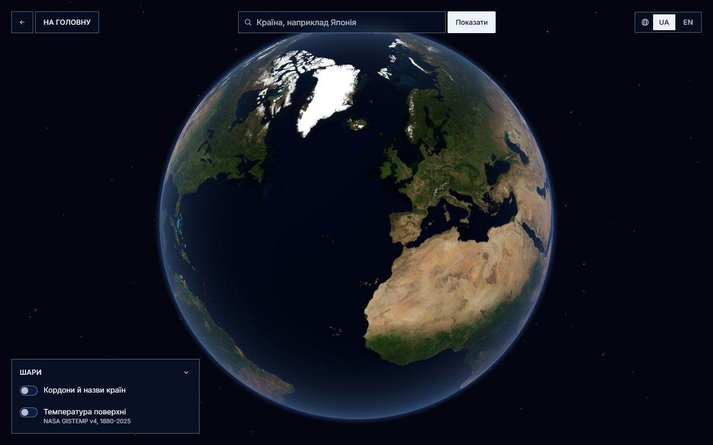
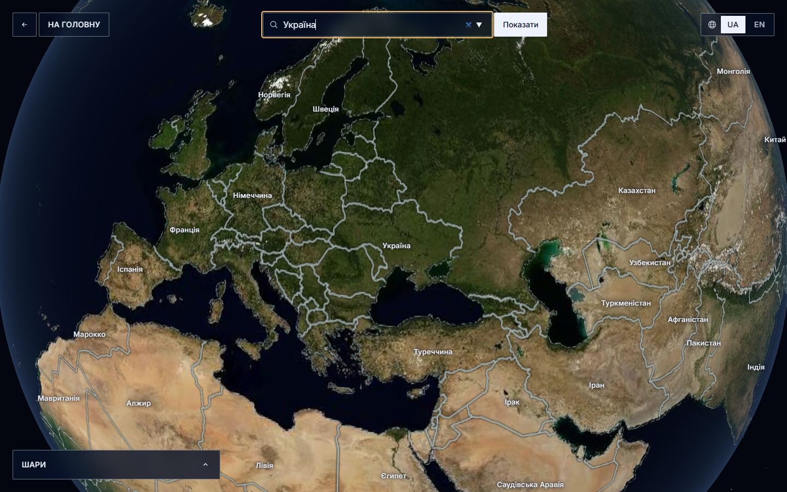
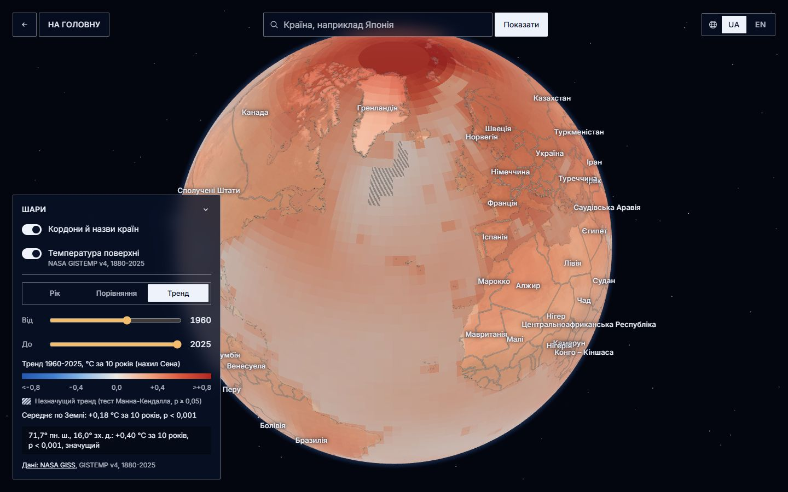
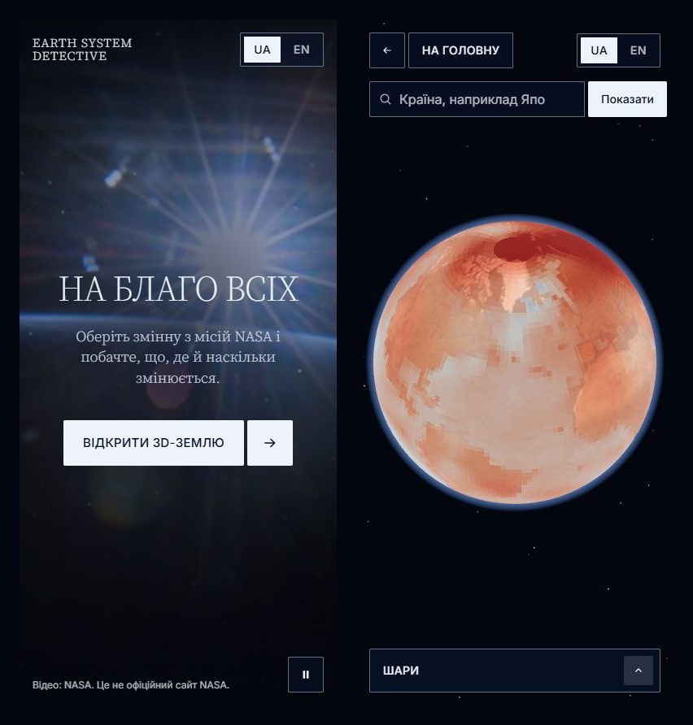

# Earth System Detective

[Українська](README.md) | **English**

A team of three students taking part in the NASA Space Apps Challenge 2026
hackathon with Noosphere.

**Earth System Detective** is our project for the challenge
[Earth System Trend Detective](https://www.spaceappschallenge.org/2026/challenges/earth-system-trend-detective/):
a 3D Earth where you pick a NASA variable and see what is changing, where, by how
much, and whether the change is statistically significant.

**Live site:** https://luufus.github.io/Earth-System-Detective-/


## What is here

### Home page

One screen, no scrolling: NASA footage (sunrise over Earth from the ISS, Earth
by day and by night, the PACE satellite being built and launched), the headline
"For the Benefit of All" and a button into the 3D Earth. Ukrainian and English.

### 3D Earth (`/explore`)



- **Rotate and zoom** with the mouse, wheel or fingers, down to about 380 km above
  the surface. Closer in, the globe fetches a sharp NASA GIBS image of just the
  visible area (Blue Marble, 500 m per pixel).
- **Find a country**: type "Ukraine", "Japan" or a name in Ukrainian and the
  camera flies there.
- **Borders and country names**: international boundaries and coastlines from
  NASA GIBS, country names in the site language.



### Surface temperature layer (NASA GISTEMP v4)

Temperature anomalies against 1951-1980 on a 2x2 degree grid, 1880-2025.

- **Year**: the anomaly in one year.
- **Compare**: the difference between two years, for example 2025 minus 1960.
- **Trend**: the rate of change in every cell (degrees per decade, Theil-Sen
  slope) tested with Mann-Kendall; cells with p of 0.05 or more are hatched.
- Hover over or tap the globe to read a value; the legend shows the global mean.




### On a phone



## Run it

```bash
cd frontend
npm install
npm run dev
```

The browser opens by itself. Code, data and how to refresh GISTEMP are in
[`frontend/README.en.md`](frontend/README.en.md); colours, type and components in
[`DESIGN.md`](DESIGN.md).

## Deployment

Every push to `main` runs GitHub Actions
([`.github/workflows/pages.yml`](.github/workflows/pages.yml)): the site is built
and published to the `gh-pages` branch, which GitHub Pages serves.

## Repository layout

| Path | What |
|---|---|
| `frontend/` | React + TypeScript + Vite app, Three.js globe |
| `data-pipeline/` | Python scripts that turn NASA datasets into files for the site |
| `docs/screenshots/` | Screenshots for this README |
| `DESIGN.md` | Design system: colours, type, components |

## Data sources

NASA GISS (GISTEMP v4), NASA GIBS, NASA Image and Video Library, NASA JSC Crew
Earth Observations. This is not an official NASA website, and NASA does not
endorse the project.
