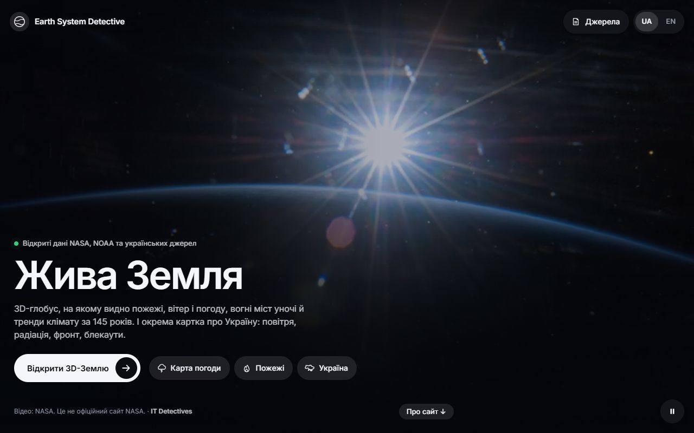
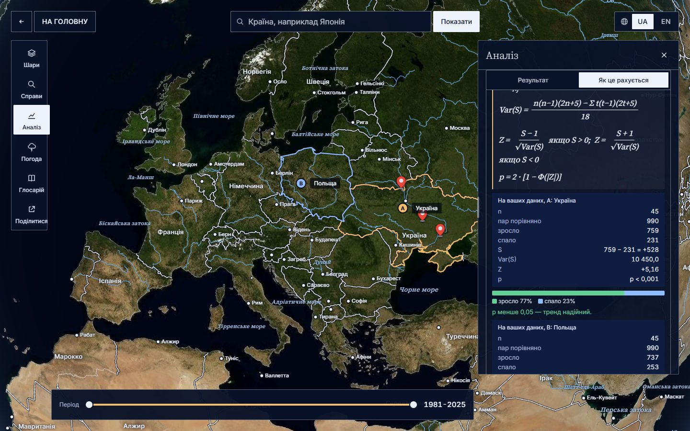
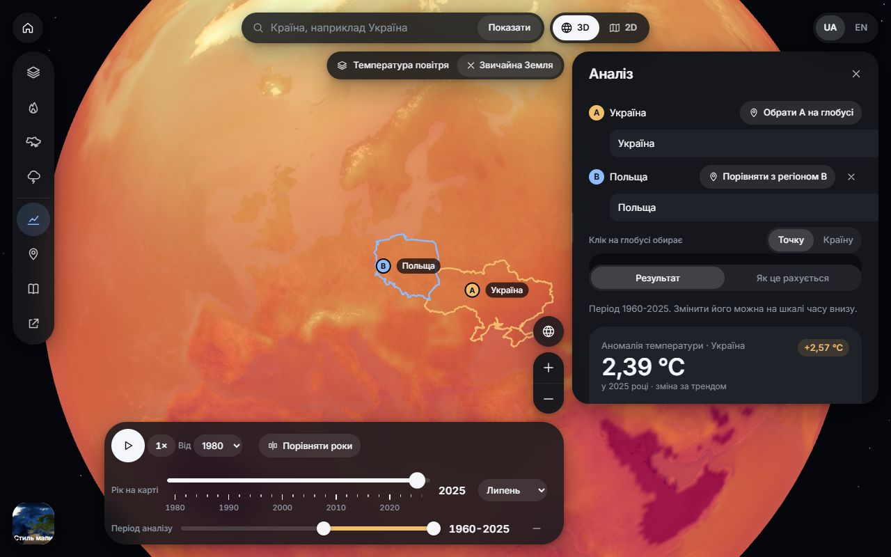

# Earth System Detective

[Українська](README.md) | **English**

A team of three students taking part in the NASA Space Apps Challenge 2026
hackathon with Noosphere.

**Earth System Detective** is our project for the challenge
[Earth System Trend Detective](https://www.spaceappschallenge.org/2026/challenges/earth-system-trend-detective/):
a 3D Earth where you pick a NASA variable and see what is changing, where, by how
much, and whether the change is statistically significant.

**Live site:** https://luufus.github.io/Earth-System-Detective-/



## What is here

### Home page

One screen, no scrolling: NASA footage (sunrise over Earth from the ISS, Earth
by day and by night, the PACE satellite being built and launched), the headline
"For the Benefit of All" and a button into the 3D Earth. Ukrainian and English.

### 3D Earth (`/explore`): the "Studio"


Tools on the left: **Layers, Cases, Analysis, Weather, Glossary, Share**; a
timeline with Play at the bottom; the analysis drawer on the right.

- **Rotate and zoom** with the mouse, wheel or fingers, down to about 95 km.
  Up close the globe loads sharp NASA GIBS imagery for the visible area (Blue
  Marble 500 m, then Landsat 30 m).
- **Country search**: type "Ukraine", "Japan" or "Японія" and the camera flies
  there.
- **Borders and names**: crisp white borders with a dark halo (readable on any
  imagery and at any zoom), coastlines, country names, **capitals** as small
  dots, **oceans and seas** and **rivers** with names in Ukrainian or English.
  Borders follow Ukraine's point of view: Crimea is part of Ukraine. Data:
  Natural Earth.


- **Values under the pointer**: the coordinates plus temperature, humidity,
  precipitation and wind from NASA POWER for the month and year on the
  timeline, over land and ocean.


- **NASA data layers**: GISTEMP temperature anomaly (1880-2025), air
  temperature, precipitation, soil moisture and humidity (NASA POWER), the ozone
  hole, and over Ukraine NO₂, vegetation, land surface temperature and fires;
  GIBS imagery for night lights and true colour. A separate layer shows the
  occupation and hostilities in Ukraine from the official list.
- **Hints**: red map pins mark notable events (Kakhovka, the Aral Sea, the
  Chornobyl zone fires and more); the card says what happened and links NASA.

### Comparing regions and countries

Click any place (region A) and add region B, or pick **whole countries**: type
a name or switch "A click on the globe picks: A country". The countries are
outlined on the globe and the numbers come only from inside their borders. The
drawer says in plain words what changed and by how much, shows a reliability
light (the Mann-Kendall test), the rate of change (Theil-Sen slope) and which
one changes faster.


### Years, months, days, and a chart you can stretch

Chart views: **years**, **months**, **days** (daily NASA POWER data) or the
**seasonal cycle**. For months and days the trend is checked with the seasonal
Mann-Kendall test. The chart zooms with the wheel or buttons, pans with the
mouse, has a navigator strip below, a dot per value and a full-screen mode.


### "How it is computed"

For each method: where it shows on screen, plain words, the formula, and the
same arithmetic on your data: how many pairs of years went up and down, S,
Var(S), Z, p, the slope, its confidence interval, and how many years a
conclusion needs.



### Weather and hazards

For any place: a 7-day forecast (rain, thunderstorms, gusts), the official
**tornado** probability from the NOAA Storm Prediction Center (USA only: there
are no official odds elsewhere, so we do not make them up), and how often rain,
heat, frost or strong wind happen there from NASA POWER, 1981-2000 against
2006-2025, with a Mann-Kendall trend test.


### Surface temperature layer (NASA GISTEMP v4)

Temperature anomalies against 1951-1980 on a 2°×2° grid, 1880-2025.

- **Year**: the anomaly for the chosen year.
- **Compare**: the difference between two years, for example 2025 minus 1960.
- **Trend**: the rate of change in every cell (°C per decade, Theil-Sen slope)
  with a Mann-Kendall significance test. Cells that are not significant
  (p ≥ 0.05) are hatched.




### Other tools

From the analysis drawer the same region opens in NASA Worldview, Giovanni,
Earthdata Search and the CUAHSI hydrology services (HydroShare, HydroClient),
or downloads as a NASA POWER CSV.

### On a phone


## Run it

```bash
cd frontend
npm install
npm run dev
```

The browser opens by itself. Code, data and how to refresh GISTEMP are in
[`frontend/README.en.md`](frontend/README.en.md); colours, type and components in
[`DESIGN.md`](DESIGN.md).

## Deployment

Every push to `main` runs GitHub Actions
([`.github/workflows/pages.yml`](.github/workflows/pages.yml)): the site is built
and published to the `gh-pages` branch, which GitHub Pages serves.

## Repository layout

| Path | What |
|---|---|
| `frontend/` | React + TypeScript + Vite app, Three.js globe |
| `data-pipeline/` | Python scripts that turn NASA datasets into files for the site |
| `docs/screenshots/` | Screenshots for this README |
| `DESIGN.md` | Design system: colours, type, components |

## Data sources

NASA GISS (GISTEMP v4), NASA GIBS, NASA POWER (MERRA-2), NASA Ozone Watch, OMI,
MODIS, NASA FIRMS, NASA Image and Video Library, NASA JSC Crew Earth
Observations; Natural Earth maps (public domain); Open-Meteo forecasts; NOAA
Storm Prediction Center tornado outlooks. This is not an official NASA website, and NASA does not
endorse the project.
