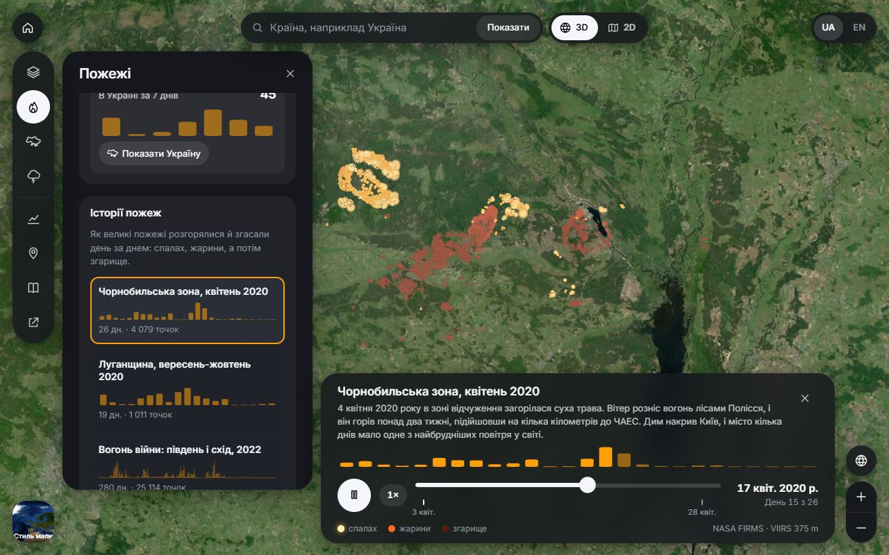
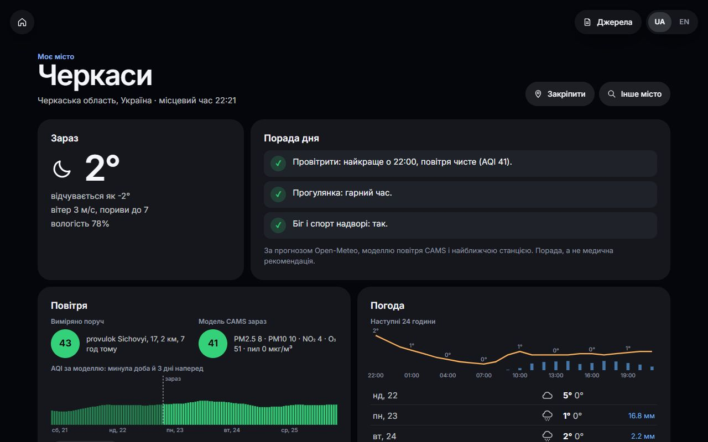
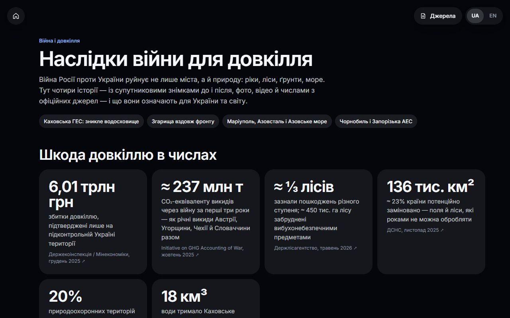
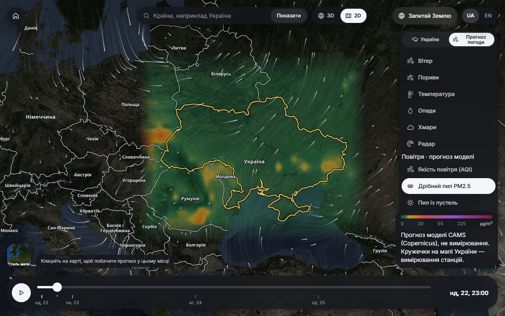
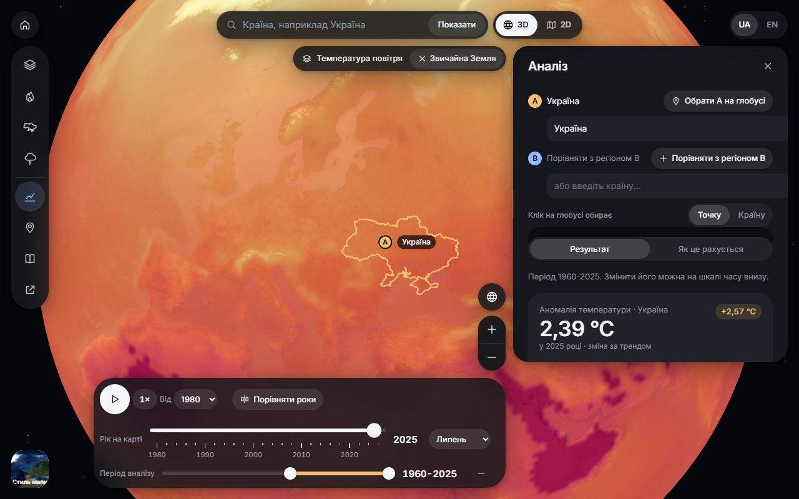
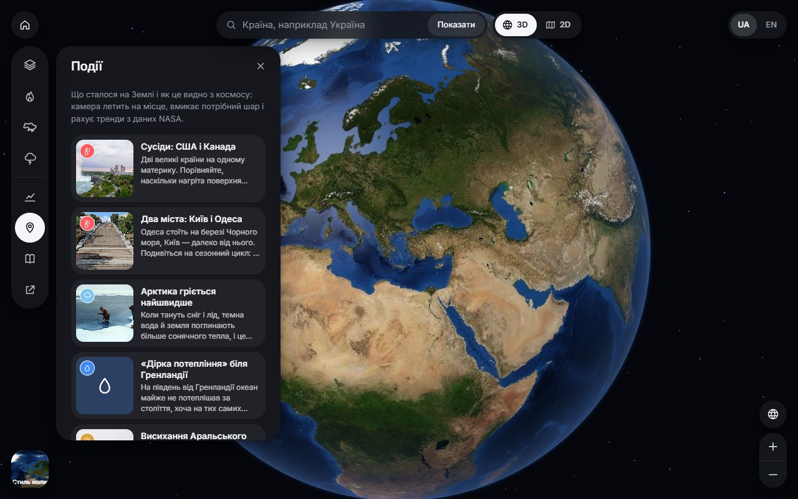
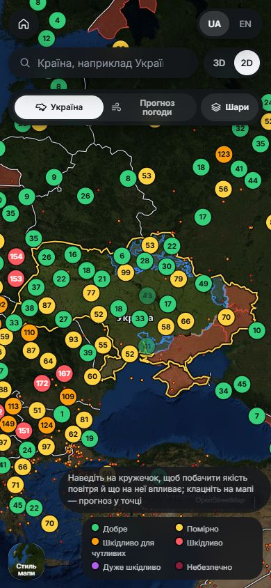
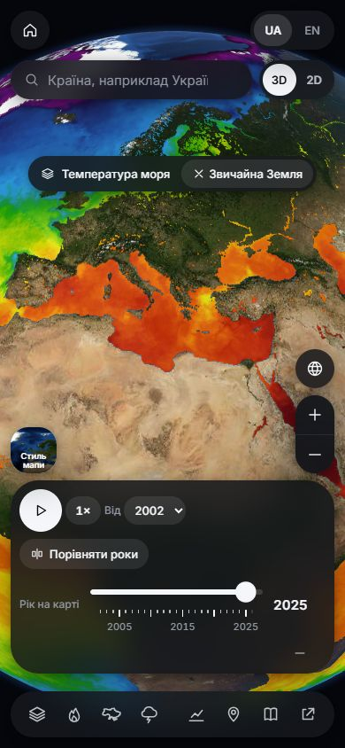

# Earth System Detective

[Українська](README.md) | **English**

**A living 3D Earth from NASA's open data: what is happening to the planet now, what has changed over
decades, and what is happening in Ukraine.**

**Live site:** https://luufus.github.io/Earth-System-Detective-/ · **Made by:** IT Detectives
(Maksym Semenov and Anastasiia Chupyra)


## About the project

NASA's and other agencies' satellites measure air and ocean temperature, rain, snow and ice,
vegetation, air pollution, fires and city lights at night every day. The data are open, but scattered
across dozens of archives, formats and services, and hard for most people to reach. **Earth System
Detective** brings them together on an interactive globe and a 2D map that simply open in a browser.

On the site you can:

- **see** the Earth as satellites see it: 20+ NASA data layers, the real Sun and the night side with
  city lights, every fire of the last 48 hours, wind and the weather forecast;
- **check** whether a change is real: the site computes trends straight from NASA data with
  statistical tests (Mann-Kendall and Sen's slope) and says in plain words what changed, by how much,
  and whether it is significant;
- **compare** two countries, two regions or two years;
- **find out** what is happening in Ukraine: air quality, the front line, occupied communities,
  radiation, fires and blackouts after the strikes on the power grid;
- **understand** events: what happened, why, who or what caused it and what can be done;
- **follow your own city**: the weather, the air (measured and forecast by a model), fires nearby, how
  the climate has changed and the advice of the day — on one page;
- **see the war’s toll on the environment**: the Kakhovka dam, burned land along the front, Azovstal,
  Chornobyl and the Zaporizhzhia plant — with images before and after and sources;
- **ask the Earth** in plain words: “Is it getting warmer in Cherkasy?” — and get an answer with
  numbers.

### Why

News about climate and the environment often says "it got worse" without numbers or sources. We
wanted anyone — a pupil, a teacher, a journalist, a volunteer — to be able to open the data
themselves, see what is happening, where and by how much, and tell a real trend from chance. So the
site follows three rules:

1. **Open data only**, with the source named next to every layer, event and number.
2. **Nothing made up.** Where there is no data, the site says so; it names only causes visible in the
   data (wind, rain, fires nearby, the CAMS model).
3. **Numbers with a check.** A trend is shown together with whether it is statistically significant.

### History

The project started at the **NASA Space Apps Challenge 2026** hackathon (challenge
[Earth System Trend Detective](https://www.spaceappschallenge.org/2026/challenges/earth-system-trend-detective/),
hosted locally by Noosphere) as a globe of temperature trends. Since then we have kept developing it
for ourselves: fires, Ukraine, weather, air quality, events and a new design.

## Contents

- [3D Earth and layers](#3d-earth-and-layers)
- [The real Sun, night and blackout](#the-real-sun-night-and-blackout)
- [Fires](#fires)
- [Map of Ukraine](#map-of-ukraine)
- [My city](#my-city)
- [The war’s toll on the environment](#the-wars-toll-on-the-environment)
- [Weather forecast](#weather-forecast)
- [Air quality forecast](#air-quality-forecast)
- [Ask the Earth](#ask-the-earth)
- [Trend analysis and comparison](#trend-analysis-and-comparison)
- [Events](#events)
- [Home page and phone](#home-page-and-phone)
- [How it works](#how-it-works)
- [Run it](#run-it)
- [Tests](#tests)
- [Data sources](#data-sources)

The screenshots show the Ukrainian interface; the site switches to English with one button.

## 3D Earth and layers


The main screen (`/explore`) is a Three.js globe with NASA GIBS satellite imagery and relief. On the
left, a tool column: **Layers, Fires, Ukraine, Weather, Analysis, Events, Glossary, Share**; in the
middle, country search and a 3D / 2D switch; at the bottom, a timeline.

- **20+ NASA layers on shelves**: temperature (GISTEMP anomaly since 1880, air, land surface, sea),
  water (GPM and MERRA-2 rain, water vapour, humidity, soil moisture, snow, sea ice), air (nitrogen
  dioxide, ozone, carbon monoxide, dust, aerosols, wind), land (NDVI vegetation, land cover, fires),
  people (night lights, population density).
- **Layer hints**: each layer has a scale with numbers and units and an explanation of the colours;
  the pointer shows the value at a place in words.
- **Year player**: "From" — the year to play from to the latest; the bottom bar folds away.
- **Zoom to street level**: close up the globe loads a sharper image of the visible area, and gaps
  between satellite passes are filled from neighbouring values, so layers do not break into "pixels".
- **Borders and names**: country borders (Crimea as part of Ukraine), capitals, seas, rivers.


**Under the pointer**, anywhere on Earth: the place, the temperature now (NOAA GFS), wind, local time,
the value of the layer that is on, fires and air quality nearby, and the nearest event.

## The real Sun, night and blackout


Three lighting styles: **even**, **the real Sun now** (the night side with NASA Black Marble city
lights) and **the whole planet at night**.


**Blackout**: Ukraine at night on 3 October 2021 and on 25 November 2022 (after massive strikes on the
power grid) under a before/after slider.

## Fires


- **Fires now**: every detection of the last 48 hours from NASA FIRMS — VIIRS (NOAA-20, NOAA-21,
  Suomi NPP satellites, 375 m) and MODIS (Terra, Aqua, 1 km). The colour shows how many hours ago the
  fire was seen. Updated every hour; NASA publishes detections about 1–3 hours after the overpass.
- **Ukraine over 7 days**: the number of fires and a chart by day.
- **Big fires day by day**: the Chornobyl zone (April 2020), Luhansk region (September–October 2020),
  the front (2022), Evia and Turkey (2021), Quebec (2023). You see fire flare up, smoulder and leave a
  burn scar.



## Map of Ukraine


A separate 2D map (`/map?mode=ukraine`, MapLibre): Ukraine highlighted, its neighbours dimmed (zoomed
out to the world the dimming fades). Map styles: relief, satellite, OpenStreetMap.

- **Air quality**: the AQI (US EPA scale) inside each bubble, coloured from "good" to "hazardous".
  Data from SaveEcoBot, Sensor.Community open sensors and, with a token, the World Air Quality Index
  (WAQI). Readings older than 3 hours are drawn faded.
- **Station card**: the district (OpenStreetMap), the main pollutant, PM2.5, PM10, NO₂, O₃, SO₂ and CO
  sub-indices, and what the data show nearby: fires, still air, rain, humidity, dust and gases from
  the Copernicus CAMS model.
- **The DeepState front line** with its history since April 2022; **occupied communities** from the
  official list of Ukraine's Ministry of Development; **radiation** from Safecast in µSv/h; **fires**
  from NASA FIRMS.
- The **weather forecast** can go over the map.


## My city



The `/city` page: choose a town by name or with “Where am I”, and one screen has what matters today.
**Pin** the city and it shows on the home page with its temperature and AQI (kept in this browser
only).

- **Now** and the **weather** for 24 hours and 7 days (Open-Meteo).
- **Air**: the AQI of the nearest station (SaveEcoBot, Sensor.Community, WAQI; with when it was
  measured) and the CAMS model now, over the last day and 3 days ahead.
- **Advice of the day**: the best time to air the rooms, whether to go for a walk or a run, strong sun
  (UV) and desert dust — with the reasons from the data. Advice, not medical guidance.
- **Fires nearby**: NASA FIRMS detections within 50 km over 48 hours.
- **How the climate has changed**: the yearly temperature since 1981 (NASA POWER) with Sen’s slope and
  the Mann-Kendall test, e.g. “+2.5 °C since 1981, a significant trend”.

## The war’s toll on the environment



The `/war` section — four stories of what the war does to Ukraine’s nature:

- **The Kakhovka dam** — Landsat images (NASA Earth Observatory) before and after with a slider: the
  reservoir, the flood on the Dnipro, the irrigation canals of the south;
- **Burned land along the front** — forests, mines, emissions from landscape fires;
- **Mariupol, Azovstal and the Sea of Azov** — industrial pollution, warnings that were never
  confirmed, and fake photos;
- **Chornobyl and the Zaporizhzhia plant** — occupation, the drone strike on the confinement arch, the
  plant’s power losses.

Each has what happened, **what it means for Ukraine and for the world**, photos under free licences
with their authors (no photos of the dead or wounded), and videos with their channels named (IAEA,
EBRD, EPRS, AP, UATV) that load from YouTube without cookies only when played. At the top, **the
damage in numbers**: environmental damage, war emissions, forests, mined land, protected areas, the
Kakhovka reservoir — each with its date and a link to the primary source.


## Weather forecast


A map in the spirit of Windy (`/map?mode=weather`): the American **NOAA GFS** model's forecast 72
hours ahead in 3-hour steps.

- Layers: animated **wind** lines, **gusts**, **temperature**, **rain and snow**, **cloud** and the
  RainViewer **precipitation radar** for the last two hours.
- **Forecast player**: the wind flows smoothly between steps and the colour layer cross-fades.
- **Forecast at a point**: click anywhere for hourly temperature and rain and the strongest wind
  (Open-Meteo).
- On the 3D Earth, the Weather section gives a 7-day forecast anywhere, the tornado probability from
  the NOAA Storm Prediction Center (US only: there is no other official data) and "how often it
  happens here" for rain, heat, frost or strong wind in 1981–2000 versus 2006–2025.


## Air quality forecast



The weather map has an **“Air · model forecast”** group: the AQI, fine particles PM2.5 and desert dust
from the Copernicus CAMS model over Ukraine and its neighbours, 3 days ahead in 3-hour steps. The
player shows smoke and dust moving, with the wind lines and station cards of the same moment. It is
labelled honestly as **a model, not measurements**; the bubbles on the map of Ukraine are station
measurements.

## Ask the Earth


The **Ask the Earth** button at the top of every page: type a question in plain words — “Is it getting
warmer in Cherkasy?”, “What is the air like in Kyiv now?”, “Are there fires near Kharkiv?”, “What is
the weather tomorrow in Odesa?” — and the site finds the place, works out the answer from the data and
links to the globe, map or city page.

No AI yet: the site reads the topic (temperature, rain, snow, air, fires, weather, ice, war) and the
place (a country by name, a town via Open-Meteo search, undoing Ukrainian case endings). The answer is
computed with the same methods as the analysis (Sen’s slope, Mann-Kendall). Claude can be connected
here later to understand any question.

## Trend analysis and comparison



Pick a country, a region or a point (region A), and the Analysis panel shows the data series and
checks it for a trend.

- **Mann-Kendall test**: whether the change is statistically significant (a reliability traffic
  light); the seasonal version for months and days.
- **Sen's (Theil-Sen) slope**: how fast the change goes, with a confidence interval.
- **Chart views**: years, months, days (daily NASA POWER data) and the seasonal cycle; the chart
  zooms, pans, goes full screen and saves as an image or CSV.
- **Comparison**: add region B — two countries or regions on one chart, and which changes faster.
  Countries are outlined on the globe, and the numbers are computed inside their borders only.
- **"How it is computed"**: for each method, a plain explanation, the formula and the same
  computation on your data (S, Var(S), Z, p, slope, interval).
- **GISTEMP layer**: the temperature anomaly for a year, the difference between two years and the
  trend in each 2°×2° cell since 1880; non-significant cells are hatched.
- The same region opens in NASA Worldview, Giovanni, Earthdata Search and CUAHSI services
  (HydroShare, HydroClient).


## Events



Events visible from space: fires, deforestation, droughts, floods, melting ice, volcanoes, air
pollution, heat, war. On the globe they are markers by category; in the Events section, a list with
photos. Pick one and the camera flies there and turns on the right layer. Each says **what happened,
why, who or what caused it and what can be done**, with Wikimedia Commons photos (authors and
licences given) and links to sources.


## Home page and phone


Home: NASA footage (sunrise over Earth from the ISS, Earth by day and by night, the PACE launch),
buttons into the 3D Earth, weather, fires and Ukraine, and below them "About": what the site is, why,
how to start, each part with a screenshot, how the data update, who it is for and the authors. The
**Sources** button lists every data source. The site works in Ukrainian and English, and on phones.

| Home | Map of Ukraine | 3D Earth |
|---|---|---|
|  |  |  |

## How it works

**Browser** (`frontend/`): React 19, TypeScript and Vite.

- **Globe**: Three.js with custom shaders — day and night by the real position of the Sun, relief,
  atmosphere. NASA GIBS imagery loads in tiles, with a separate sharp patch for the visible area close
  up.
- **2D map**: MapLibre GL; wind and station bubbles are drawn on their own canvases over the map.
- **Analysis**: statistics in the browser — Mann-Kendall tests (plain and seasonal), the Theil-Sen
  slope with a confidence interval.
- **Web Workers** (with Comlink): forecast frames are painted on a background thread with
  OffscreenCanvas, so the map and globe keep moving during playback (about 45 frames a second).
- Animations: springs from the design system (Jelly slider, Stat card).

**Data** (`data-pipeline/`, Python): some servers do not serve browsers on other sites, so scripts
collect the data and publish it as files.

- `build_live.py` — the NOAA GFS forecast (its own GRIB2 reader, no ecCodes), NASA FIRMS fires (VIIRS
  and MODIS), Sensor.Community sensors with a filter for broken ones (readings many times above their
  neighbours) and the AQI on the US EPA 2024 scale. The data are compressed so the site loads faster.
- The same script fetches the CAMS air quality forecast (Open-Meteo) twice a day on a 0.5° grid
  over Ukraine and its neighbours; in between it reuses the one already published.
- `build_fire_stories.py` — big fires from the FIRMS archives.
- Other scripts prepare GISTEMP, the ozone hole, NO₂ and MODIS over Ukraine, occupied communities,
  Natural Earth borders and names.

Everything else the browser fetches directly: NASA GIBS and POWER, Open-Meteo and Copernicus CAMS,
SaveEcoBot, WAQI, RainViewer, DeepState, Safecast, OpenStreetMap Nominatim, Wikimedia Commons.

### How the data update

| What | Source | How often |
|---|---|---|
| Fires, last 48 hours | NASA FIRMS (VIIRS, MODIS) | every hour |
| Weather forecast | NOAA GFS 1° | every hour (new runs every 6 hours) |
| Air quality | SaveEcoBot, Sensor.Community, WAQI | every hour |
| Air quality forecast | Copernicus CAMS via Open-Meteo | twice a day |
| Precipitation radar | RainViewer | every few minutes |
| Front line | DeepState | as soon as a change is published |
| NASA layers and series | GIBS, POWER, GISTEMP | as new months come out |

## Run it

```bash
cd frontend
npm install
npm run dev
```

The browser opens by itself. While `npm run dev` runs, the server refreshes fires and air every hour
(and the GFS forecast once it is over 6 hours old) by running `data-pipeline/build_live.py` (Python
with numpy). By hand: `npm run live`.

**WAQI air quality.** Get a free token at https://aqicn.org/data-platform/token/ and put it in
`frontend/.env.local` (kept out of git):

```bash
VITE_WAQI_TOKEN=your_token
```

For the GitHub Pages site, add the same token as the repository secret `WAQI_TOKEN`
(Settings → Secrets and variables → Actions). Without a token the site uses SaveEcoBot and
Sensor.Community.

Code, data and how to refresh GISTEMP are in [`frontend/README.en.md`](frontend/README.en.md);
colours, type and components in [`DESIGN.md`](DESIGN.md).

## Tests

```bash
cd frontend
npm test            # Vitest: statistics, AQI, advice, question parsing, forecast fields
npm run test:e2e    # Playwright in the installed Chrome: the site in a real browser
npm run screenshots # Playwright: retake the screenshots for this README
```

- **Vitest** checks the Mann-Kendall tests and Sen’s slope against values computed independently in
  SciPy (`frontend/tests/reference/`), and the AQI, station search, advice and question parsing. The
  tests run before every deployment: if something breaks, the site is not updated.
- **Playwright** opens the site in Chrome and checks what broke before: the real Sun from the first
  second, year labels, air bubbles, smooth forecast playback (no frame over 400 ms), the phone layout,
  My city, the war section and Ask the Earth.

## Deployment

Every push to `main`, and an hourly schedule, run GitHub Actions
([`.github/workflows/pages.yml`](.github/workflows/pages.yml)): fresh fires, air and forecast are
collected, the site is built and published to the `gh-pages` branch, which GitHub Pages serves.

## Repository layout

| Path | What |
|---|---|
| `frontend/src/components/` | Globe, map, panels, cards |
| `frontend/src/pages/` | Pages: home, 3D Earth (`Explore`), 2D map (`WeatherMap`) |
| `frontend/src/data/` | Loading and processing data in the browser |
| `frontend/src/analysis/` | Statistics: Mann-Kendall, Sen's slope, data series |
| `frontend/src/workers/` | Background threads: painting forecast fields |
| `frontend/e2e/` | Playwright tests and screenshots |
| `frontend/tests/reference/` | Reference statistics from SciPy |
| `frontend/src/i18n/` | Ukrainian and English text |
| `frontend/public/data/` | Prepared data: GISTEMP, borders, fire stories |
| `data-pipeline/` | Python scripts that collect and prepare data |
| `docs/screenshots/` | Screenshots for this README |
| `DESIGN.md` | Design system: colours, type, components |

## Data sources

NASA GISS (GISTEMP v4), NASA GIBS, NASA POWER (MERRA-2), NASA Ozone Watch, OMI, MODIS, NASA FIRMS,
NASA Black Marble, NASA Image and Video Library, NASA JSC Crew Earth Observations; NOAA GFS; NOAA
Storm Prediction Center; RainViewer; Open-Meteo; Copernicus CAMS via Open-Meteo; DeepState;
SaveEcoBot; Sensor.Community; World Air Quality Index (WAQI); Safecast (CC0);
NASA Earth Observatory; CEOBS; UNEP; the IAEA (via the World Nuclear Association); Ukraine's State
Environmental Inspectorate, State Forest Resources Agency and State Emergency Service; the Initiative
on GHG Accounting of War; IAEA, EBRD, EPRS, AP and UATV videos on YouTube; Open-Meteo town search
(GeoNames); the list of occupied
communities from Ukraine's Ministry of Development; Natural Earth maps (public domain) and
OpenStreetMap (ODbL); photos from Wikimedia Commons (authors and licences in the event cards).

## Authors

**IT Detectives** — Maksym Semenov and Anastasiia Chupyra. Built with Claude (Anthropic).

This is not an official NASA website, and NASA does not endorse the project.
