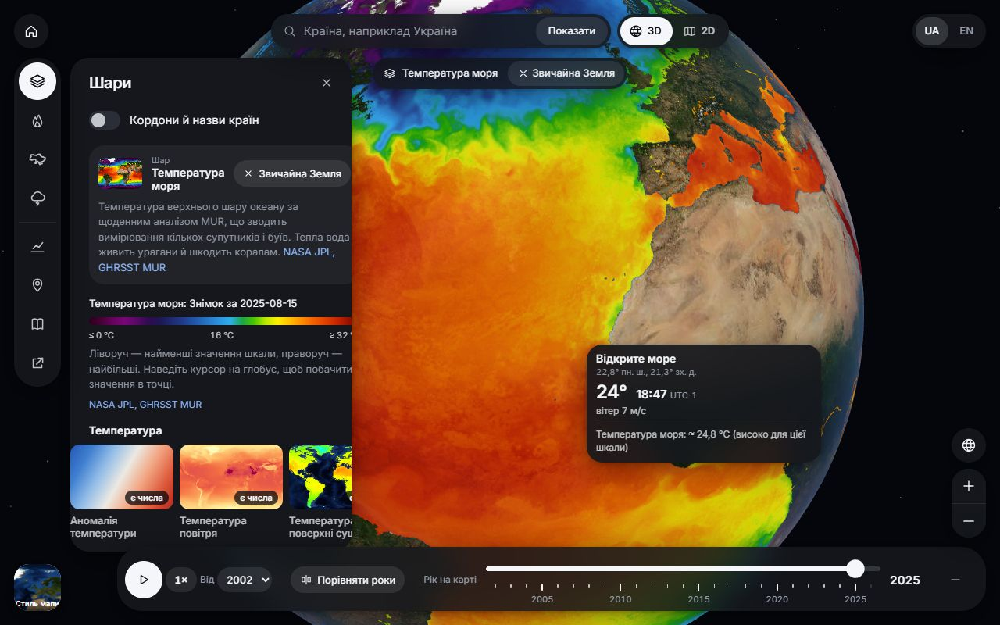
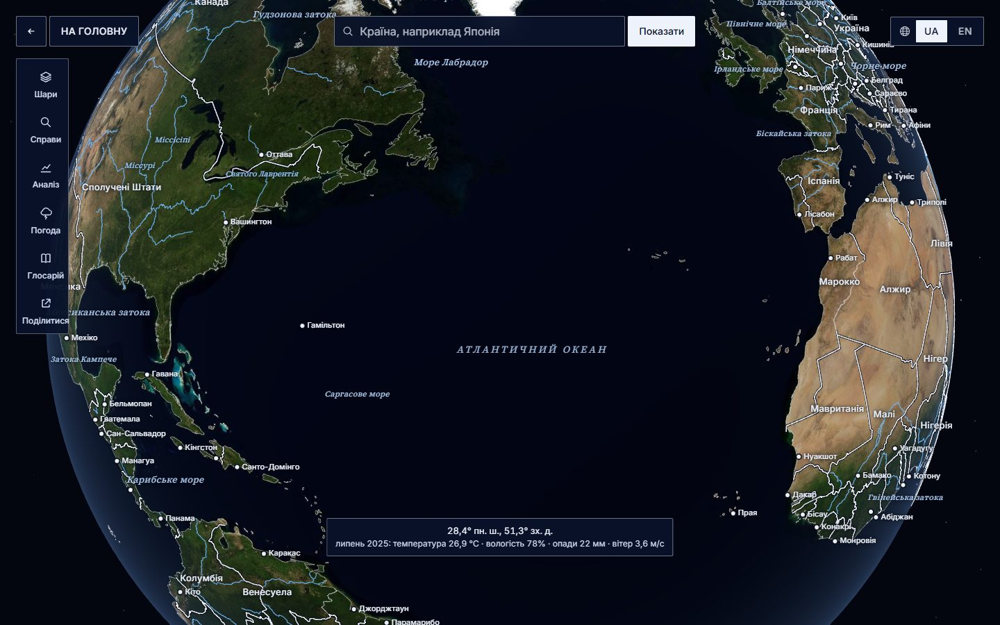
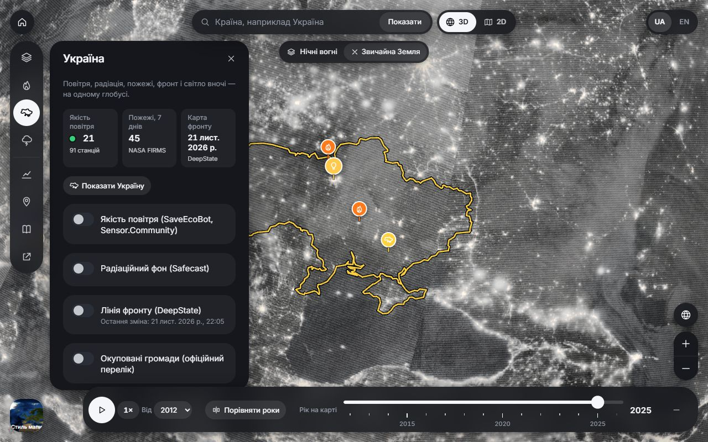
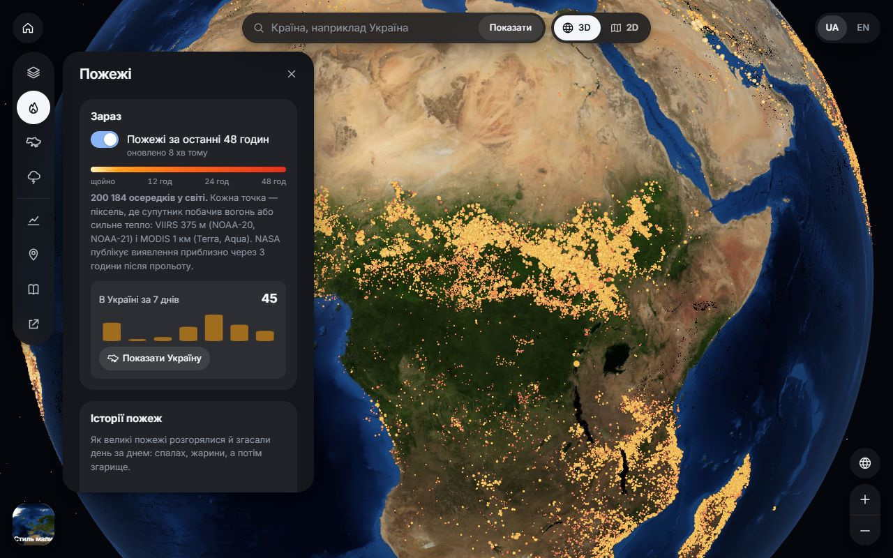
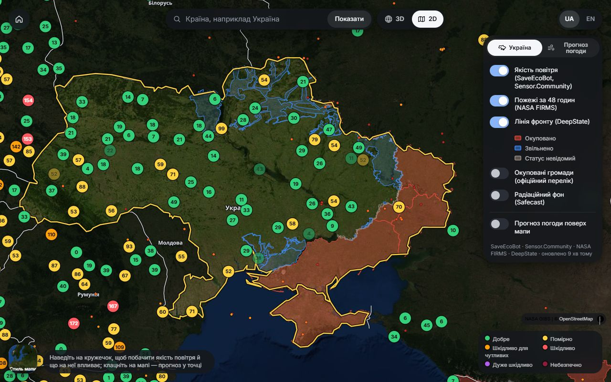
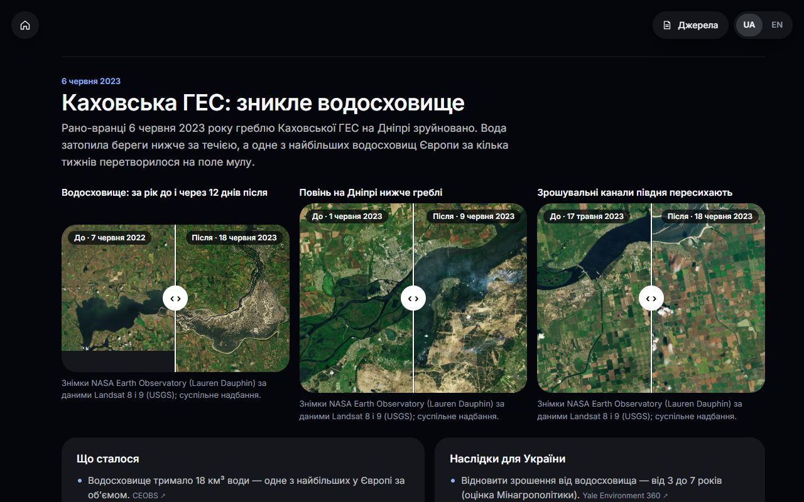
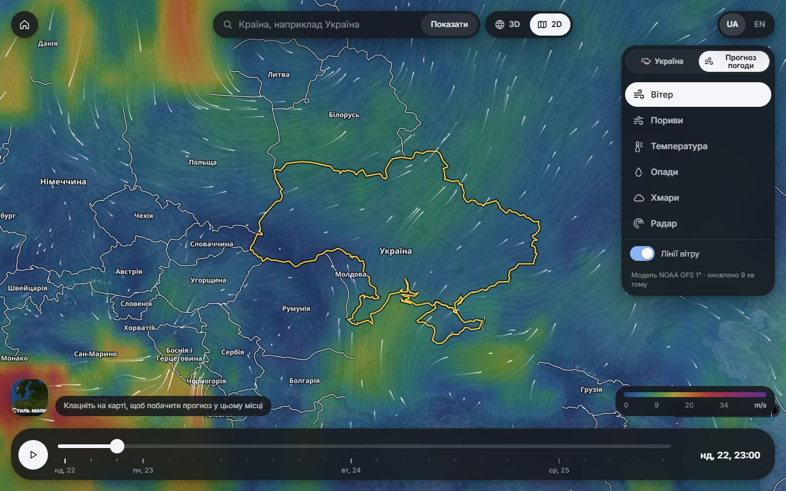
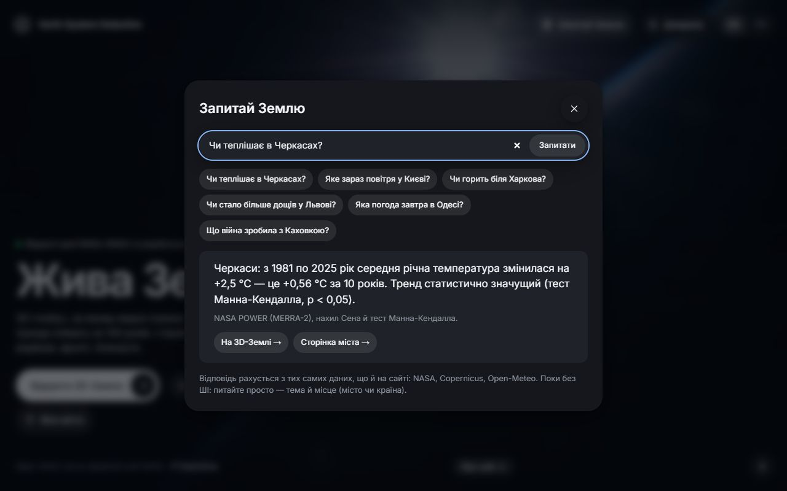
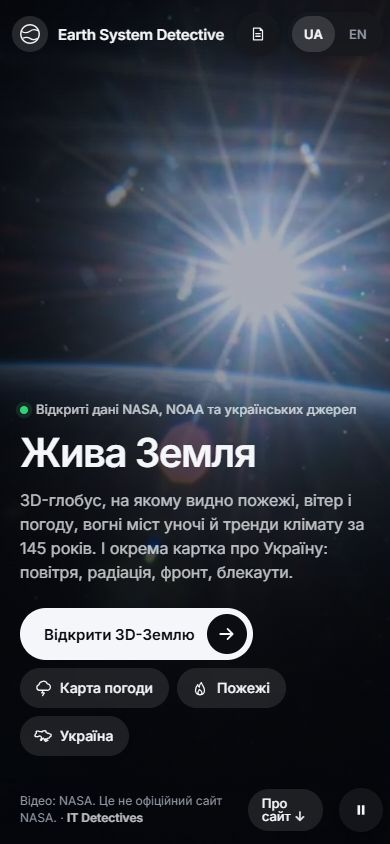

# Earth-System-Detective

**Українська** | [English](README.en.md)

**Жива 3D-Земля з відкритих даних NASA: що відбувається з планетою зараз, що змінилося за десятиліття
і що відбувається в Україні.**

**Сайт:** https://luufus.github.io/Earth-System-Detective-/ · **Автори:** IT Detectives (Семенов
Максим і Анастасія Чупира)


## Про проєкт

Супутники NASA й інших агентств щодня вимірюють температуру повітря й океану, опади, сніг і лід,
рослинність, забруднення повітря, пожежі, нічні вогні міст. Ці дані відкриті, але розкидані по
десятках архівів, форматів і сервісів, і пересічній людині до них важко дістатися. **Earth System
Detective** зводить їх в одне місце: на інтерактивний глобус і 2D-мапу, які можна просто відкрити в
браузері.

На сайті можна:

- **побачити** Землю такою, як її бачать супутники: понад 20 шарів даних NASA, справжнє Сонце й
  нічна сторона з вогнями міст, усі пожежі за останні 48 годин, вітер і прогноз погоди;
- **перевірити**, чи зміна справжня: сайт рахує тренд прямо з даних NASA статистичними тестами
  (Манна-Кендалла й нахил Сена) і простими словами пише, що змінилося, наскільки і чи це значуще;
- **порівняти** дві країни, два регіони чи два роки;
- **дізнатися**, що відбувається в Україні: якість повітря, лінія фронту, окуповані громади,
  радіаційний фон, пожежі й блекаути після ударів по енергосистемі;
- **зрозуміти** події: що сталося, чому, хто чи що спричинило і що можна зробити;
- **дізнатися про своє місто**: погода, повітря (виміряне й за прогнозом моделі), пожежі поруч, як
  змінився клімат і порада дня — на одній сторінці;
- **побачити наслідки війни для довкілля**: Каховська ГЕС, згарища вздовж фронту, Азовсталь,
  Чорнобиль і Запорізька АЕС — зі знімками до і після та джерелами;
- **запитати Землю** звичайними словами: «Чи теплішає в Черкасах?» — і отримати відповідь із
  числами.

### Для чого

Новини про клімат і довкілля часто звучать як «стало гірше» без чисел і джерел. Ми хотіли, щоб
будь-хто — школяр, учитель, журналіст, волонтер — міг сам відкрити дані й побачити, що відбувається,
де і наскільки, і відрізнити справжній тренд від випадковості. Тому на сайті три правила:

1. **Тільки відкриті дані** з назвою джерела біля кожного шару, події й числа.
2. **Нічого не вигадувати.** Якщо даних немає, сайт так і пише; причини забруднення чи пожежі він
   називає лише ті, що видно в даних (вітер, опади, пожежі поруч, модель CAMS).
3. **Числа з перевіркою.** Тренд показується разом із тим, чи він статистично значущий.

### Історія

Проєкт почався на хакатоні **NASA Space Apps Challenge 2026** (челендж
[Earth System Trend Detective](https://www.spaceappschallenge.org/2026/challenges/earth-system-trend-detective/),
організатор у нас — Noosphere) як глобус з трендами температури. Після хакатону ми розвиваємо його
для себе: додали пожежі, Україну, погоду, якість повітря, події й новий дизайн.

## Зміст

- [3D-Земля і шари](#3d-земля-і-шари)
- [Справжнє Сонце, ніч і блекаут](#справжнє-сонце-ніч-і-блекаут)
- [Пожежі](#пожежі)
- [Мапа України](#мапа-україни)
- [Моє місто](#моє-місто)
- [Наслідки війни для довкілля](#наслідки-війни-для-довкілля)
- [Прогноз погоди](#прогноз-погоди)
- [Прогноз якості повітря](#прогноз-якості-повітря)
- [Запитай Землю](#запитай-землю)
- [Аналіз трендів і порівняння](#аналіз-трендів-і-порівняння)
- [Події](#події)
- [Головна сторінка й телефон](#головна-сторінка-й-телефон)
- [Як це працює](#як-це-працює)
- [Як запустити](#як-запустити)
- [Тести](#тести)
- [Джерела даних](#джерела-даних)

## 3D-Земля і шари



Головний екран (`/explore`) — глобус на Three.js із супутниковими знімками NASA GIBS і рельєфом.
Зліва колонка інструментів із підписами: **Шари, Пожежі, Україна, Погода, Аналіз, Події, Глосарій,
Поділитися**; по центру пошук країни й перемикач 3D / 2D; знизу шкала часу. Панель, що виїжджає зліва,
можна **розширити чи звузити**: потягніть її правий край (або стрілки ← → на клавіатурі; кнопка в
заголовку перемикає звичайну й широку панель); ширина запам’ятовується. На екранах вужчих за 1500 px
відкрита лише одна бічна панель (ліва або «Аналіз»), щоб вони не закривали глобус.

- **«Увімкнено»** угорі посередині: усе, що зараз показано (шари, пожежі за 48 годин, повітря, радіація,
  фронт, погода, порівняння років, кордони), з кнопкою вимкнути кожне одним кліком або все разом.

- **Понад 20 шарів NASA на полицях**: температура (аномалія GISTEMP з 1880 року, повітря, поверхня
  суші, море), вода (опади GPM й MERRA-2, водяна пара, вологість, волога ґрунту, сніг, морський лід),
  повітря (діоксид азоту, озон, чадний газ, пил, аерозолі, вітер), суша (рослинність NDVI, типи
  земель, пожежі), люди (нічні вогні, густота населення).
- **Кілька шарів разом**: до трьох шарів одночасно, наприклад пожежі поверх аерозолів чи NO₂; новий
  шар лягає зверху, пожежі завжди видно. Головний (останній) шар дає шкалу й роки.
- **Міста** (у «Кордони й назви країн», поруч зі столицями, морями й річками): понад 3 тисячі міст
  світу від 100 тис. людей і міста України з населенням; що ближче наблизите, то більше міст.
  Клацніть місто — картка з населенням, площею забудови, повітрям, радіацією й пожежами поруч.
  Місто можна знайти в панелі «Аналіз»: введіть назву в поле A чи B (зокрема менші — через
  геокодер Open-Meteo). Пошук угорі глобуса шукає лише країни.
- **Підказки до шарів**: під кожним шаром — шкала з числами й одиницями та пояснення, що означає
  колір; під курсором — значення в точці словами.
- **Програвач років**: «Від» — з якого року програвати до останнього; нижню панель можна згорнути.
- **Наближення до вулиць**: зблизька глобус довантажує чіткіший знімок видимої ділянки, а прогалини
  між проходами супутника заповнюються сусідніми значеннями, тож шари не розпадаються на «пікселі».
- **Кордони й назви**: кордони країн (Крим у складі України), столиці, моря, річки.
- **Глосарій**: понад 40 термінів у чотирьох розділах (тренди й статистика, дані з космосу, повітря,
  пожежі й війна) з пошуком. Для кожного — що це простими словами, **формула** (Манн-Кендалл, нахил
  Сена, AQI, NDVI, оптична товща…), **як читати числа** (пороги, одиниці, норми ВООЗ), приклад з
  розрахунком і де це на сайті.



**Під курсором** будь-де на Землі: місце, температура зараз (NOAA GFS), вітер, місцевий час, значення
ввімкненого шару (для архіву пожеж — чи була тут точка вогню того дня), пожежі за останні 48 годин і
якість повітря поруч, а також подія в радіусі 80 км — з її датою й відстанню.

## Справжнє Сонце, ніч і блекаут


Три стилі освітлення: **рівне**, **справжнє Сонце зараз** (нічна сторона з вогнями міст NASA Black
Marble) і **вся планета вночі**.



**Блекаут**: Україна вночі 3 жовтня 2021 року і 25 листопада 2022 року (після масованих ударів по
енергосистемі) під шторкою «до / після».

## Пожежі



- **Пожежі зараз**: усі осередки за останні 48 годин із системи NASA FIRMS — прилади VIIRS
  (супутники NOAA-20, NOAA-21, Suomi NPP, 375 м) і MODIS (Terra, Aqua, 1 км). Колір показує, скільки
  годин тому побачено вогонь. Дані оновлюються щогодини; NASA публікує виявлення приблизно через
  1–3 години після прольоту.
- **Два шари пожеж і різниця між ними**: шар «Пожежі» — архів однієї обраної доби обраного року
  (його можна гортати по добах і порівнювати шторкою), «Пожежі за 48 годин» — те, що супутники бачать
  зараз. Тому живі точки завжди свіжіші; поки порівнюються роки, вони сховані. Архів бере точки з
  векторних плиток NASA GIBS одразу з трьох супутників: Suomi NPP у 2026 році перестав передавати
  пожежі, тож новіші доби — з NOAA-20 і NOAA-21.
- **В Україні за 7 днів**: кількість пожеж і графік по днях.
- **Історії великих пожеж** день за днем: Лос-Анджелес (січень 2025), Квебек (2023), фронт (2022),
  Евбея й Туреччина (2021), Чорнобильська зона й Луганщина (2020), весняне паління полів в Україні
  (квітень 2018) і воєнні: нафтобаза під Васильковом (лютий 2022), завод «Азот» у Сєвєродонецьку
  (червень 2022), порти Одеси й Чорноморська (липень 2023), масована атака на Київ (червень 2025).
  Точки вогню — з архівів NASA FIRMS двох супутників (Suomi NPP і NOAA-20). Видно, як вогонь
  спалахує, жевріє й лишає згарище.
- **Де горить найбільше зараз**: найсильніші скупчення вогню світу за 48 годин (вулкани відсіяно), із
  числом осередків за добу проти попередньої. Клацніть — і сайт порахує: куди піде дим за прогнозом
  вітру NOAA GFS (якщо вогонь горітиме, як зараз), погоду для вогню на 3 дні (індекс Фосберга FFWI з
  температури, вологості й вітру за прогнозом Open-Meteo) і чи погіршиться повітря в містах навколо
  (прогноз моделі CAMS).
- **Дим і вітер**: кнопка в історії наближає мапу й показує кілька днів, коли дим важив найбільше:
  клуби диму від кожного вогнища несе справжній вітер тих годин (реаналіз ERA5), стрілки вітру — лише
  біля пожежі, а в містах навколо кружечки з якістю повітря (модель CAMS), які червоніють, коли
  приходить дим. Поруч — що сталося, чому, які наслідки (зокрема місто з найгіршим повітрям) і що з
  цим робити; для війни (фронт, удари) — окремі поради. Дим малює відеокарта (Three.js): тисячі
  м'яких клубів одним викликом, і на 3D-Землі, і на 2D-мапі (власний шар MapLibre).


## Мапа України



Окрема 2D-мапа (`/map?mode=ukraine`, MapLibre): Україна підсвічена, сусіди затемнені (при віддаленні
до всього світу затемнення зникає). Стилі мапи: рельєф, супутник, OpenStreetMap.

- **Якість повітря**: число AQI (шкала US EPA) у кружечку; колір — від «чисте» до «небезпечне».
  Дані SaveEcoBot, відкритих датчиків Sensor.Community і, з токеном, World Air Quality Index
  (WAQI). Виміри старші за 3 години напівпрозорі.
- **Картка станції** простими словами: «Повітря брудне — шкодить усім», **чого не радимо** (бігати,
  провітрювати, палити листя…), **що допоможе** (респіратор FFP2, очищувач повітря) і **чому повітря
  може бути таким** (дим від паління трави й пічного опалення, пил з доріг, вихлопи). Закріплена картка
  показує ще район, головний забруднювач, індекси PM2.5, PM10, NO₂, O₃, SO₂, CO і що поруч за даними:
  пожежі, безвітря, опади, вологість, пил і гази з моделі Copernicus CAMS.
- **Окуповані території й лінія фронту DeepState**; **окуповані громади** за офіційним переліком
  Мінрозвитку.
- **Пожежі за 48 годин**: здалеку — точки за віком і силою вогню, зблизька — вогники. Клацніть пожежу:
  коли її побачив супутник, наскільки вона сильна, біля якого міста, чи це громада з офіційного
  переліку територій бойових дій або окупованих — і кнопка **«Куди піде дим»**: шлейф за прогнозом
  вітру NOAA GFS на добу й міста, до яких він може дійти (дальність залежить від сили вогню).
- **Міста** — точки з назвами, які можна клацнути, і пошук міста з карткою.
- **Удари з пожежами й дим**: позначки задокументованих ударів, після яких супутники бачили вогонь, і
  їхній список у панелі. Клацніть — сцена «Дим і вітер» відкривається просто на мапі: куди вітер ніс
  дим, яким було повітря в містах, чому це сталося, які наслідки й що робити. На час сцени живі шари
  (повітря, радіація, пожежі за 48 годин) ховаються, щоб не плутати сьогодні з минулим.
- **Радіаційний фон на станціях по всьому світу**: Україна — SaveEcoBot; Німеччина й Фінляндія —
  державні мережі BfS і STUK; решта — волонтерські лічильники Safecast і Sensor.Community (менш
  точні, картка про це попереджає). Кожна позначка — окрема станція з числом у мкЗв/год і кольором
  рівня (низький, звичайний, підвищений, високий). Повітря й радіацію можна ввімкнути разом: ярлик радіації, що налазив би на кружечок повітря, стає поруч і з'єднується лінією зі своєю станцією. Картка станції простими словами пояснює, що означає число, скільки це за рік і що робити.
  Те саме — на 3D-Землі, у «Моєму місті» й у відповідях «Запитай Землю» («Яка радіація в Києві?»).
- **Хронологія окупації з 2022 року** (на мапі й на 3D-Землі): програвач тиждень за тижнем — від
  лінії до 24 лютого 2022 року до сьогодні. Тижні плавно перетікають один в одний; захоплене за
  останні 4 тижні підсвічено бурштиновим, звільнене — синім. Над повзунком — дата, площа окупованого
  (≈ км² і % України), скільки захоплено й звільнено за тиждень і графік площі з ключовими датами
  (північ, Харківщина, Херсон, Бахмут, Авдіївка); клацніть графік, щоб перейти на дату.
- Поверх мапи можна ввімкнути **прогноз погоди**.


## Моє місто


Сторінка `/city`: оберіть місто за назвою або кнопкою «Де я зараз» — і на одному екрані буде все, що
важливо сьогодні. Місто можна **закріпити**: тоді воно показується на головній з температурою й
AQI (зберігається лише в цьому браузері).

- **Зараз** і **погода** на 24 години й на 7 днів (Open-Meteo).
- **Повітря**: AQI найближчої станції (SaveEcoBot, Sensor.Community, WAQI; показано, коли виміряно) і
  модель CAMS зараз, за минулу добу й на 3 дні вперед.
- **Порада дня**: коли найкраще провітрити, чи йти на прогулянку чи пробіжку, чи сильне сонце (УФ) і
  чи прийде пил із пустель — і чому, з причинами з даних. Це порада, а не медична рекомендація.
- **Пожежі поруч**: осередки NASA FIRMS у радіусі 50 км за 48 годин.
- **Як змінився клімат**: річна температура з 1981 року (NASA POWER) з нахилом Сена й тестом
  Манна-Кендалла, наприклад «+2,5 °C з 1981 року, тренд значущий».

## Наслідки війни для довкілля


Розділ `/war` — чотири історії про те, що війна робить із природою України:

- **Каховська ГЕС** — знімки Landsat (NASA Earth Observatory) до і після з повзунком: водосховище,
  повінь на Дніпрі, зрошувальні канали півдня;
- **Згарища вздовж фронту** — ліси, міни, викиди від ландшафтних пожеж;
- **Маріуполь, Азовсталь і Азовське море** — промислове забруднення, попередження, які не
  підтвердилися, і фейкові фото;
- **Чорнобиль і Запорізька АЕС** — окупація, удар дрона по арці конфайнменту, втрати живлення ЗАЕС.

Для кожної — що сталося, **наслідки для України й для світу**, фото під вільними ліцензіями з
авторами (без фото загиблих і поранених) і відео з указаними каналами (МАГАТЕ, ЄБРР, EPRS, AP,
UATV), які вантажаться з YouTube без cookie лише після натискання. Угорі — **шкода в числах**: збитки
довкіллю, викиди війни, ліси, заміновані території, заповідні території, Каховське водосховище —
кожне число з датою й посиланням на першоджерело (Держекоінспекція, Initiative on GHG Accounting of
War, Держлісагентство, ДСНС, CEOBS, UNEP, МАГАТЕ).



## Прогноз погоди



Мапа в дусі Windy (`/map?mode=weather`): прогноз американської моделі **NOAA GFS** на 72 години з
кроком 3 години.

- Шари: **вітер** з анімацією ліній, **пориви**, **температура**, **опади**, **хмари** і **радар
  опадів** RainViewer за останні дві години.
- **Програвач прогнозу**: вітер плавно перетікає між кроками, кольоровий шар м'яко змінюється.
- **Прогноз у точці**: клацніть будь-де — температура й опади по годинах і найсильніший вітер
  (Open-Meteo).
- На 3D-Землі в розділі «Погода» — прогноз на 7 днів для будь-якого місця, ймовірність торнадо від
  NOAA Storm Prediction Center (лише США: інших офіційних даних немає) і «як часто тут буває» дощ,
  спека, мороз чи сильний вітер у 1981–2000 проти 2006–2025 років.


## Прогноз якості повітря


На карті погоди є група **«Повітря · прогноз моделі»**: AQI, дрібний пил PM2.5 і пил із пустель за
моделлю Copernicus CAMS над Україною й сусідами, на 3 дні вперед з кроком 3 години. Програвач
показує, як рухаються дим і пил, а лінії вітру й картки станцій — того самого моменту. Підписано
чесно: це **модель, не вимірювання**; кружечки на мапі України — виміри станцій. На мапі України
прогноз вмикається перемикачем «Прогноз якості повітря (модель)».

## Запитай Землю



Кнопка **«Запитай Землю»** вгорі кожної сторінки: напишіть питання звичайними словами —
«Чи теплішає в Черкасах?», «Яке зараз повітря у Києві?», «Чи горить біля Харкова?», «Яка погода
завтра в Одесі?» — і сайт сам знайде місце, порахує відповідь з даних і дасть посилання на глобус,
мапу чи сторінку міста.

Поки без штучного інтелекту: сайт розпізнає тему (температура, опади, сніг, повітря, радіація, пожежі, погода,
лід, війна) і місце (країну за назвою, місто — через пошук Open-Meteo, з українськими відмінками:
«Харкова» → Харків, «Києві» → Київ). Відповідь рахується тими самими методами, що й аналіз
(нахил Сена, тест Манна-Кендалла). Згодом сюди можна під’єднати Claude, щоб розуміти будь-які
питання.

## Аналіз трендів і порівняння


Введіть країну чи місто в поле A (або клацніть точку на глобусі) — і панель «Аналіз» покаже ряд
даних і перевірить, чи є в ньому стійка зміна.

- **Коротко простими словами** — лише з виміряних чисел: перший і останній рік і різниця між ними,
  найбільше й найменше, звичайний рік і чи зміна стійка. Під кожним числом — що воно означає
  («скільки дощу випало за рік»).
- **Роки**: період «від — до» будь-якої довжини або **окремі роки** (до 6). Кожен обраний рік
  порівнюється зі звичайним роком і з іншими обраними, місяць за місяцем. Два й більше обраних років
  глобус показує шторкою; кнопка «Порівняти роки» на шкалі часу — те саме: її повзунки змінюють
  обрані роки в аналізі.
- **Глобус слідує за графіком**: обрали «Пожежі» — на глобусі шар пожеж того самого року.
- **Продовження тренду** на 10 років показується лише на прохання і лише для стійкої зміни; воно не
  виходить за фізичні межі (пожеж не буває менше нуля, вологості — понад 100%).
- **Чесні межі даних**: якщо країна лише частково потрапляє в дані (NDVI, NO₂, пожежі є лише над
  Україною), сайт так і каже, а не рахує її частину як цілу.

- **Тест Манна-Кендалла**: чи зміна статистично значуща (світлофор надійності); для місяців і днів —
  сезонний варіант тесту.
- **Нахил Сена (Тейла-Сена)**: наскільки швидко йде зміна, з довірчим інтервалом.
- **Вигляди графіка**: роки, місяці, дні (добові дані NASA POWER) і сезонний цикл; графік
  масштабується, рухається, розгортається на весь екран і зберігається як картинка чи CSV.
- **Порівняння**: додайте регіон B — дві країни чи області на одному графіку, хто змінюється
  швидше. Країни обводяться на глобусі, а числа рахуються лише всередині їхніх кордонів.
- **Усе про місця**: два міста (чи дві точки) поруч за всім, що сайт уміє виміряти: населення, площа
  й густота; промзони й заводи з OpenStreetMap; зелень і рослинність (NDVI), нагрів поверхні влітку
  (NASA MODIS); пожежі поруч, якість повітря й радіація зараз; середня температура, опади й висота.
  Зелене — краще для людей, червоне — гірше; під кожним рядком — звідки число.
- **«Як це рахується»**: для кожного методу — пояснення простими словами, формула й ті самі
  обчислення на ваших даних (S, Var(S), Z, p, нахил, інтервал).
- **Шар GISTEMP**: аномалія температури за рік, різниця двох років і тренд у кожній клітинці
  2°×2° з 1880 року; незначущі клітинки заштриховані.
- Той самий регіон можна відкрити в NASA Worldview, Giovanni, Earthdata Search і в сервісах
  CUAHSI (HydroShare, HydroClient).


## Події


Події, які видно в даних з космосу: пожежі, вирубка лісів, посухи, повені, танення льоду, вулкани,
забруднення повітря, спека, війна. На глобусі вони позначені значками за категоріями, а в розділі
«Події» є дві вкладки: **Новини** (усі події від найновіших, з фільтром «Україна», «Пожежі», «Вода й
посухи»…) і **Дослідження**. Для кожної новини: **коли** (точна дата чи проміжок, наприклад «7–31 січня
2025»), **де**, що сталося, **основні причини**, **наслідки** з числами, що можна зробити, фото Wikimedia
Commons (автори й ліцензії вказано) і джерела. Кнопки в картці показують подію на глобусі **саме за ті
дні**: точки пожеж NASA FIRMS день за днем, шар за точну дату (опади, NO₂, знімок) або порівняння
«до / після» (блекаут 2021 і 2022).


## Головна сторінка й телефон


Головна: відео NASA (схід Сонця над Землею з МКС, Земля вдень і вночі, запуск супутника PACE),
кнопки до 3D-Землі, погоди, пожеж і України, а нижче — розділ «Про сайт»: що це, для чого, як
почати, кожна частина сайту зі скріншотом, як оновлюються дані, для кого й автори. Кнопка
**«Джерела»** показує всі джерела даних. Сайт працює українською й англійською і на телефоні.

| Головна | Мапа України | 3D-Земля |
|---|---|---|
|  |  |  |

## Як це працює

**Браузер** (папка `frontend/`): React 19, TypeScript і Vite.

- **Глобус** — Three.js з власними шейдерами: денна й нічна сторона за справжнім положенням Сонця,
  рельєф, атмосфера. Знімки NASA GIBS вантажаться тайлами, зблизька — окремою чіткою латкою видимої
  ділянки.
- **2D-мапа** — MapLibre GL; вітер і кружечки станцій малюються на окремих полотнах поверх мапи.
- **Аналіз** — статистика в браузері: тести Манна-Кендалла (звичайний і сезонний), нахил Тейла-Сена
  з довірчим інтервалом.
- **Web Workers** (з бібліотекою Comlink): кадри прогнозу малюються у фоновому потоці через
  OffscreenCanvas, тому карта й глобус не підвисають під час програвання (≈ 45 кадрів/с).
- Анімації — пружини з дизайн-системи (Jelly slider, Stat card).

**Дані** (папка `data-pipeline/`, Python): деякі сервери не віддають дані браузеру з іншого сайту,
тому їх збирають скрипти й викладають як файли.

- `build_live.py` — прогноз NOAA GFS (власний читач формату GRIB2, без ecCodes), пожежі NASA FIRMS
  (VIIRS і MODIS), датчики Sensor.Community з фільтром несправних (значення, що в рази вищі за
  сусідів) і AQI за шкалою US EPA 2024. Дані стискаються, щоб сайт вантажився швидше.
- Той самий скрипт двічі на добу бере прогноз якості повітря моделі CAMS (Open-Meteo) на сітці 0,5°
  над Україною й сусідами; між оновленнями бере вже опублікований з сайту.
- `build_fire_stories.py` — історії великих пожеж з архівів FIRMS.
- `build_geo.py` — кордони, підписи й список міст (`cities.json`, Natural Earth).
- `build_live.py` збирає ще й радіаційний фон станцій світу (`radiation.json`: BfS, STUK, Safecast,
  Sensor.Community).
- `build_front_history.py` — хронологія окупації: одна версія мапи DeepState на тиждень з квітня
  2022 року, лише окуповане в межах України; площі рахуються растром 0,005°, контури спрощуються
  (лише numpy).
- Інші скрипти готують GISTEMP, озонову діру, NO₂ і MODIS над Україною, окуповані громади,
  кордони й назви Natural Earth.

Решту браузер бере напряму: NASA GIBS і POWER, Open-Meteo і Copernicus CAMS, SaveEcoBot, WAQI,
RainViewer, DeepState, OpenStreetMap Nominatim, Wikimedia Commons.

### Як оновлюються дані

| Що | Джерело | Як часто |
|---|---|---|
| Пожежі за 48 годин | NASA FIRMS (VIIRS, MODIS) | щогодини |
| Прогноз погоди | NOAA GFS 1° | щогодини (нові прогони кожні 6 годин) |
| Якість повітря | SaveEcoBot, Sensor.Community, WAQI | щогодини |
| Прогноз якості повітря | Copernicus CAMS через Open-Meteo | двічі на добу |
| Радар опадів | RainViewer | щокілька хвилин |
| Лінія фронту | DeepState | щойно публікується зміна |
| Шари й ряди NASA | GIBS, POWER, GISTEMP | щойно виходять нові місяці |

## Як запустити

```bash
cd frontend
npm install
npm run dev
```

Браузер відкриється сам. Поки працює `npm run dev`, сервер сам оновлює пожежі й повітря щогодини (а
прогноз GFS — коли йому понад 6 годин), запускаючи `data-pipeline/build_live.py` (потрібен Python з
numpy). Вручну: `npm run live`.

**Якість повітря WAQI.** Отримайте безкоштовний токен на https://aqicn.org/data-platform/token/ і
покладіть його у `frontend/.env.local` (цей файл не потрапляє в git):

```bash
VITE_WAQI_TOKEN=ваш_токен
```

Для сайту на GitHub Pages додайте той самий токен у секрет репозиторію `WAQI_TOKEN`
(Settings → Secrets and variables → Actions). Без токена сайт працює з SaveEcoBot і
Sensor.Community.

Подробиці про код, дані й оновлення GISTEMP — у [`frontend/README.md`](frontend/README.md), кольори,
шрифти й компоненти — у [`DESIGN.md`](DESIGN.md).

## Тести

```bash
cd frontend
npm test            # Vitest: статистика, AQI, поради, розбір питань, поля прогнозу
npm run test:e2e    # Playwright у встановленому Chrome: сайт у справжньому браузері
npm run screenshots # Playwright: знову зняти скріншоти для цього README
```

- **Vitest** перевіряє тести Манна-Кендалла й нахил Сена на значеннях, порахованих незалежно в
  SciPy (`frontend/tests/reference/`), а ще AQI, пошук станцій, поради дня й розбір питань. Тести
  запускаються перед кожною публікацією: якщо щось зламано, сайт не оновиться.
- **Playwright** відкриває сайт у Chrome і перевіряє те, що раніше ламалося: справжнє Сонце з першої
  секунди, підписи років, кружечки повітря, плавність прогнозу (без кадрів довших за 400 мс),
  телефонну розкладку, «Моє місто», розділ про війну й «Запитай Землю».

## Публікація

Кожен пуш у гілку `main` і щогодинний запуск за розкладом запускають GitHub Actions
([`.github/workflows/pages.yml`](.github/workflows/pages.yml)): свіжі пожежі, повітря й прогноз
збираються, сайт будується й викладається в гілку `gh-pages`, звідки його показує GitHub Pages.

## Структура репозиторію

| Шлях | Що там |
|---|---|
| `frontend/src/components/` | Глобус, мапа, панелі, картки |
| `frontend/src/pages/` | Сторінки: головна, 3D-Земля (`Explore`), 2D-мапа (`WeatherMap`) |
| `frontend/src/data/` | Завантаження й обробка даних у браузері |
| `frontend/src/analysis/` | Статистика: Манн-Кендалл, нахил Сена, ряди даних |
| `frontend/src/workers/` | Фонові потоки: малювання полів прогнозу |
| `frontend/e2e/` | Тести Playwright і зйомка скріншотів |
| `frontend/tests/reference/` | Еталонні значення статистики з SciPy |
| `frontend/src/i18n/` | Тексти українською й англійською |
| `frontend/public/data/` | Підготовлені дані: GISTEMP, кордони, історії пожеж |
| `data-pipeline/` | Python-скрипти, що збирають і готують дані |
| `docs/screenshots/` | Скріншоти для цього README |
| `DESIGN.md` | Дизайн-система: кольори, шрифти, компоненти |

## Джерела даних

NASA GISS (GISTEMP v4), NASA GIBS, NASA POWER (MERRA-2), NASA Ozone Watch, OMI, MODIS, NASA FIRMS,
NASA Black Marble, NASA Image and Video Library, NASA JSC Crew Earth Observations; NOAA GFS; NOAA
Storm Prediction Center; RainViewer; Open-Meteo; Copernicus CAMS через Open-Meteo; DeepState;
SaveEcoBot (повітря й радіаційний фон); Sensor.Community; World Air Quality Index (WAQI); перелік окупованих
громад Мінрозвитку України; NASA Earth Observatory; CEOBS; UNEP; МАГАТЕ (через World Nuclear
Association); Держекоінспекція; Держлісагентство; ДСНС; Initiative on GHG Accounting of War; відео
МАГАТЕ, ЄБРР, EPRS, AP і UATV на YouTube; пошук міст Open-Meteo (GeoNames); карти Natural Earth (суспільне надбання) і OpenStreetMap (ODbL); фото
Wikimedia Commons (автори й ліцензії — у картках подій).

## Автори

**IT Detectives** — Семенов Максим і Анастасія Чупира. Сайт зроблено з Claude (Anthropic).

Це не офіційний сайт NASA, і NASA не схвалює й не підтримує цей проєкт.
