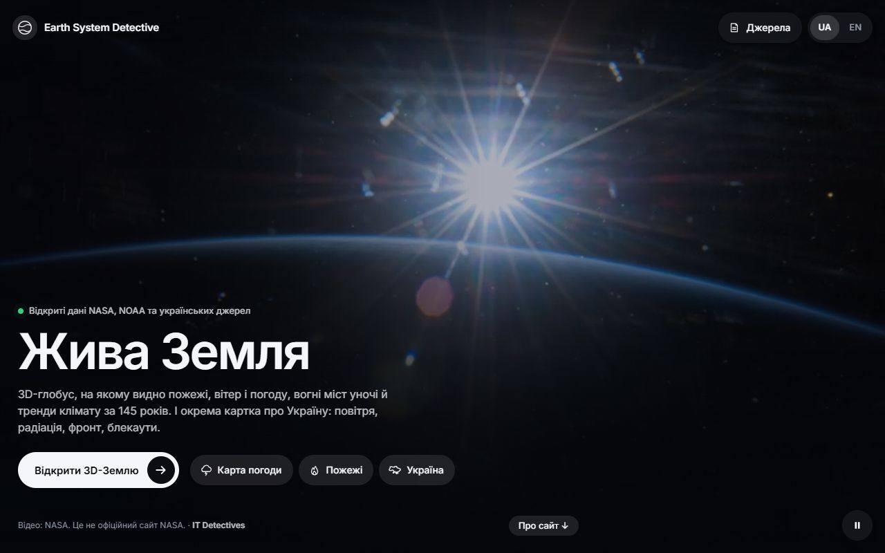
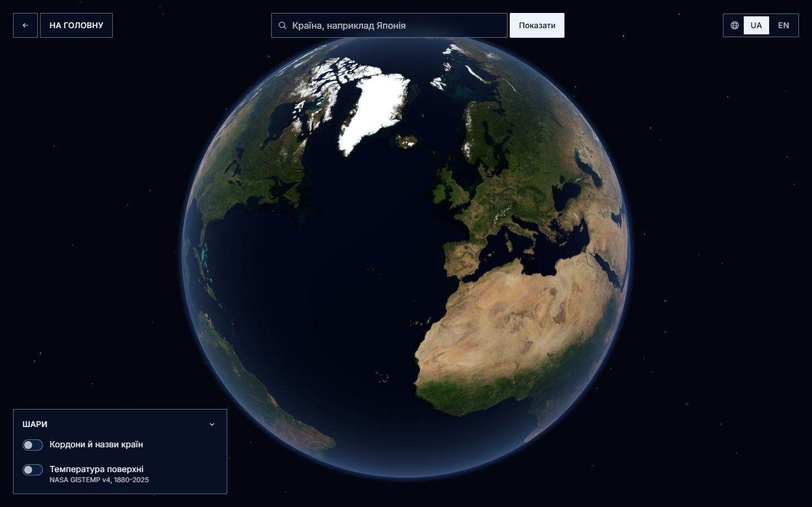
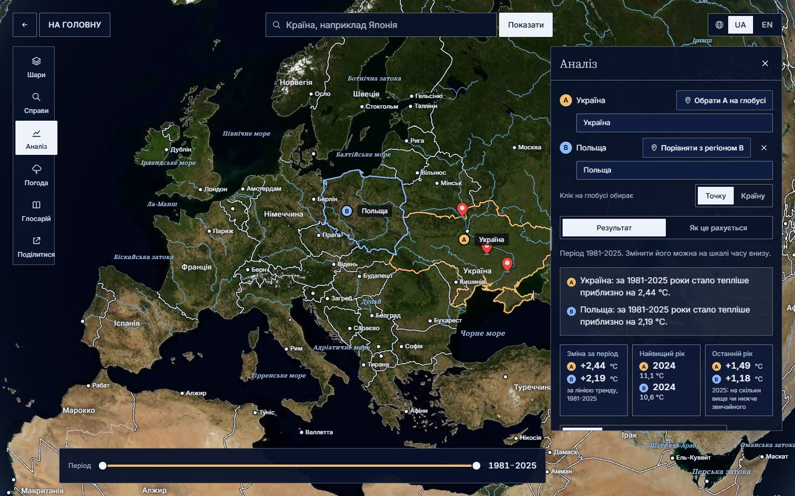
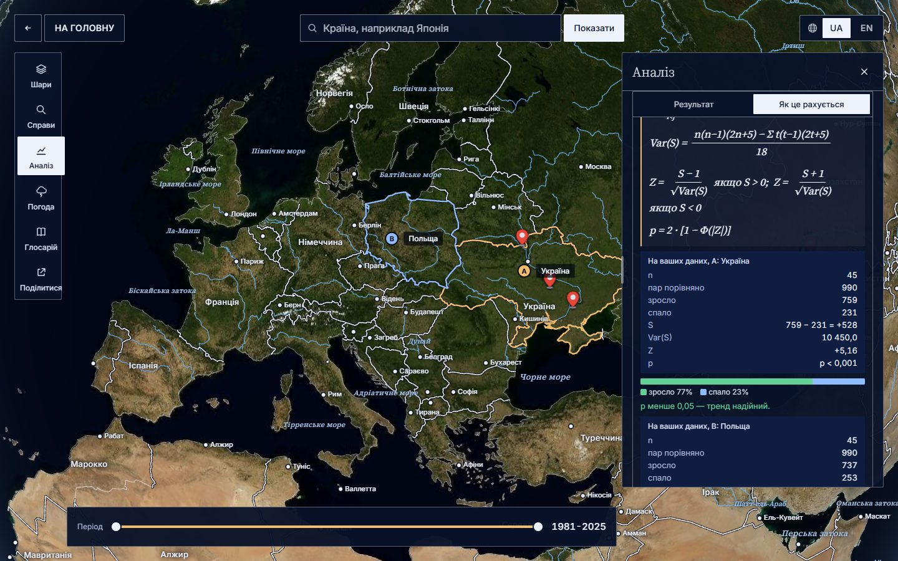
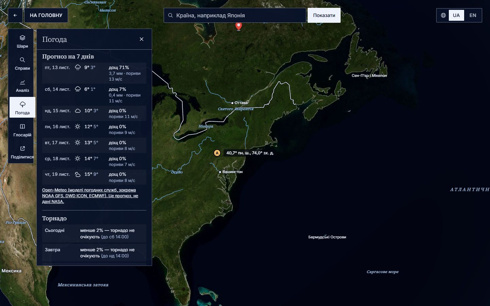
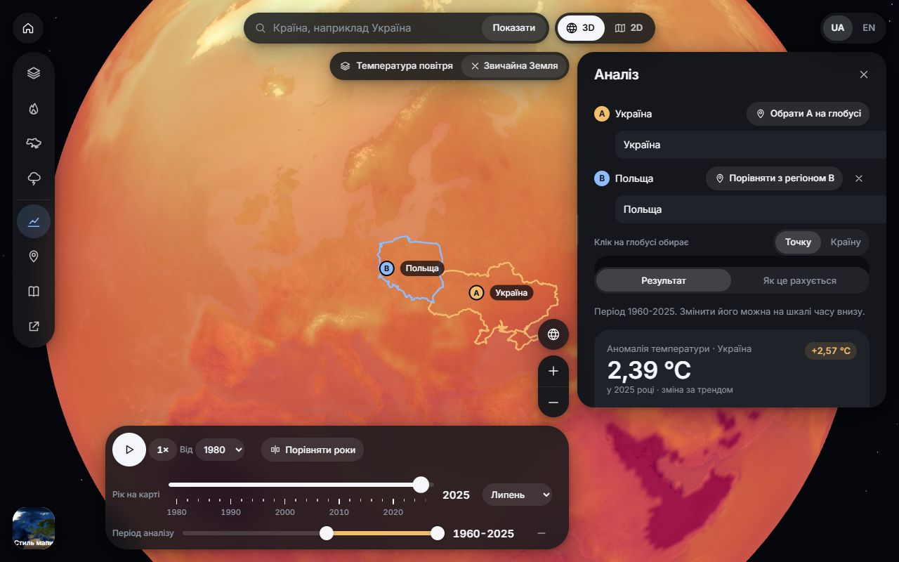
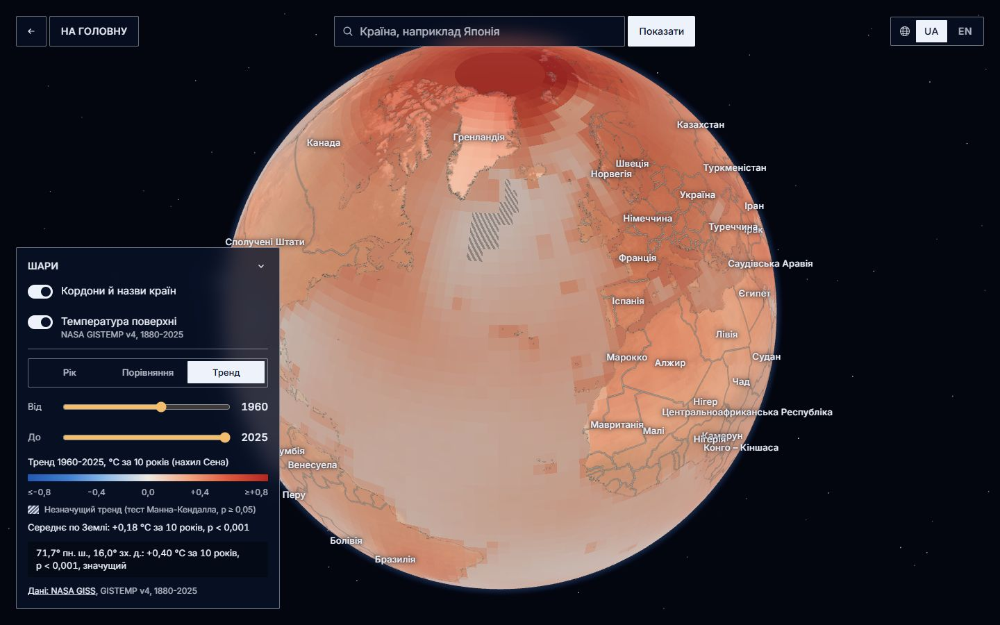

# Earth-System-Detective-
3 студєнта які приймають участь в хакатоні від Noosphere

**Українська** | [English](README.en.md)

---

**Earth System Detective** — наш проєкт для NASA Space Apps Challenge 2026,
челендж [Earth System Trend Detective](https://www.spaceappschallenge.org/2026/challenges/earth-system-trend-detective/).
Це 3D-Земля, на якій можна обрати змінну з даних NASA і побачити, що змінюється,
де, наскільки, і чи ця зміна статистично значуща.

**Сайт:** https://luufus.github.io/Earth-System-Detective-/



## Що вже є

### Головна сторінка

Один екран без прокрутки: відео NASA (схід Сонця над Землею з МКС, Земля вдень
і вночі, збирання та запуск супутника PACE), головна фраза «На благо всіх» і
кнопка переходу до 3D-Землі. Сайт працює українською та англійською.

### 3D-Земля (`/explore`): «Студія»



Зліва інструменти: **Шари, Справи, Аналіз, Погода, Глосарій, Поділитися**;
знизу шкала часу з кнопкою «Відтворити»; справа панель аналізу.

- **Обертання й масштаб**: мишею, колесом або пальцями, до ~95 км над
  поверхнею. Зблизька глобус довантажує з NASA GIBS чіткий знімок видимої
  ділянки (Blue Marble 500 м, далі Landsat 30 м).
- **Пошук країни**: вводите «Україна», «Японія» чи «Japan», і камера летить туди.
- **Кордони й назви**: чіткі білі кордони з темною обвідкою (видно на будь-якому
  знімку й наближенні), берегові лінії, назви країн, **столиці** маленькими
  точками, **океани й моря** та **річки** з назвами українською чи англійською.
  Кордони — за баченням України: Крим у складі України. Дані Natural Earth.


- **Значення під курсором**: координати, а також температура, вологість, опади
  й вітер з NASA POWER за місяць і рік на шкалі часу — над сушею й над океаном.


- **Шари даних NASA**: аномалія температури GISTEMP (1880–2025), температура
  повітря, опади, волога ґрунту й вологість (NASA POWER), озонова діра, а над
  Україною NO₂, рослинність, температура поверхні й пожежі; знімки GIBS для
  нічних вогнів і справжніх кольорів. Окремий шар — окупація й бойові дії в
  Україні за офіційним переліком.
- **Підказки**: на місцях помітних подій (Каховка, Арал, пожежі в Чорнобильській
  зоні тощо) стоять червоні шпильки; картка розповідає, що сталося, з
  посиланням на NASA.

### Порівняння регіонів і країн

Клацніть будь-яке місце (регіон A) і додайте регіон B — або оберіть **цілі
країни**: введіть назву або перемкніть «Клік на глобусі обирає: Країну». Країни
обводяться на глобусі, а числа рахуються лише всередині їхніх кордонів. Панель
каже простими словами, що змінилося і наскільки, показує світлофор
надійності (тест Манна-Кендалла), швидкість зміни (нахил Тейла-Сена) і хто
змінюється швидше.



### Роки, місяці, дні — і графік, який можна розтягувати

Вигляд графіка: **роки**, **місяці**, **дні** (добові дані NASA POWER) або
**сезонний цикл**. Для місяців і днів тренд перевіряє сезонний тест
Манна-Кендалла. Графік масштабується колесом миші чи кнопками, рухається
мишею, має смужку-навігатор унизу, точку на кожному значенні й режим «На весь
екран».


### «Як це рахується»

Для кожного методу — де він на екрані, пояснення простими словами, формула й
ті самі обчислення на ваших даних: скільки пар років зросло й спало, S, Var(S),
Z, p, нахил, довірчий інтервал, скільки років потрібно для висновку.



### Погода й небезпечні явища

Для будь-якого місця: прогноз на 7 днів (дощ, гроза, пориви), офіційна
ймовірність **торнадо** від NOAA Storm Prediction Center (лише для США: інших
офіційних даних немає, тож ми їх не вигадуємо) і «як часто тут буває» дощ,
спека, мороз чи сильний вітер за даними NASA POWER 1981–2000 проти 2006–2025,
з тестом Манна-Кендалла на тренд.



### Шар «Температура поверхні» (NASA GISTEMP v4)

Аномалії температури відносно 1951–1980 років на сітці 2°×2°, 1880–2025 роки.

- **Рік**: аномалія за обраний рік.
- **Порівняння**: різниця між двома роками, наприклад 2025 мінус 1960.
- **Тренд**: швидкість зміни в кожній клітинці (°C за 10 років, нахил Тейла-Сена)
  і перевірка значущості тестом Манна-Кендалла. Незначущі клітинки (p ≥ 0,05)
  заштриховані.





### Інші інструменти

З панелі аналізу можна відкрити той самий регіон у NASA Worldview, Giovanni,
Earthdata Search і в гідрологічних сервісах CUAHSI (HydroShare, HydroClient),
або завантажити CSV з NASA POWER.

### На телефоні


## Як запустити

```bash
cd frontend
npm install
npm run dev
```

Браузер відкриється сам. Подробиці про код, дані й оновлення GISTEMP описано у
[`frontend/README.md`](frontend/README.md), кольори, шрифти й компоненти — у
[`DESIGN.md`](DESIGN.md).

## Публікація

Кожен пуш у гілку `main` запускає GitHub Actions
([`.github/workflows/pages.yml`](.github/workflows/pages.yml)): сайт
збирається й викладається в гілку `gh-pages`, звідки його показує GitHub Pages.

## Структура репозиторію

| Шлях | Що там |
|---|---|
| `frontend/` | Застосунок на React + TypeScript + Vite, глобус на Three.js |
| `data-pipeline/` | Python-скрипти, що перетворюють набори даних NASA на файли для сайту |
| `docs/screenshots/` | Скріншоти для цього README |
| `DESIGN.md` | Дизайн-система: кольори, шрифти, компоненти |

## Джерела даних

NASA GISS (GISTEMP v4), NASA GIBS, NASA POWER (MERRA-2), NASA Ozone Watch,
OMI, MODIS, NASA FIRMS, NASA Image and Video Library, NASA JSC Crew Earth
Observations; карти Natural Earth (суспільне надбання); прогноз Open-Meteo;
торнадо NOAA Storm Prediction Center. Це не офіційний сайт NASA, і NASA не схвалює й не підтримує
цей проєкт.
