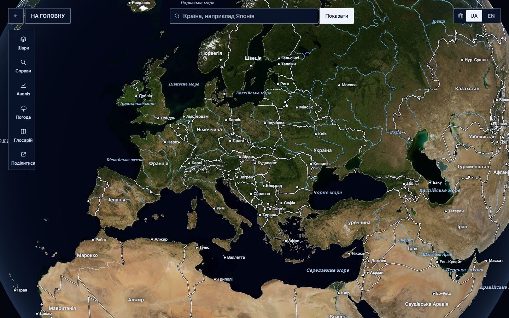
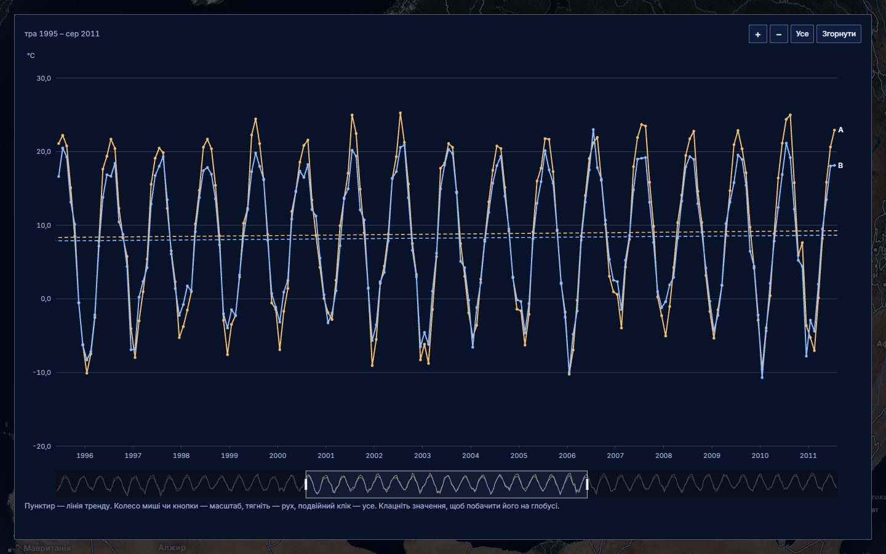

# Earth-System-Detective-
3 студєнта які приймають участь в хакатоні від Noosphere

**Українська** | [English](README.en.md)

---

**Earth System Detective** — наш проєкт для NASA Space Apps Challenge 2026,
челендж [Earth System Trend Detective](https://www.spaceappschallenge.org/2026/challenges/earth-system-trend-detective/).
Це 3D-Земля, на якій можна обрати змінну з даних NASA і побачити, що змінюється,
де, наскільки, і чи ця зміна статистично значуща.

**Сайт:** https://luufus.github.io/Earth-System-Detective-/


**Автори:** IT Detectives (Семенов Максим і Анастасія Чупира).

## Нове (листопад 2026, третя хвиля)

- **Якість повітря з WAQI** (World Air Quality Index, waqi.info): тисячі офіційних станцій по всьому
  світу, оновлення щогодини; у картці — головний забруднювач, індекси PM2.5, PM10, NO₂, O₃, SO₂, CO і
  мережа, що вимірює. Потрібен безкоштовний токен (див. «Як запустити»); без нього сайт показує
  SaveEcoBot і Sensor.Community, як раніше.
- **Плавний прогноз**: вітер на 2D-карті плавно перетікає між 3-годинними кроками (один крок за
  2 секунди), кольоровий шар м'яко змінюється, кадри малюються наперед і не створюють нових текстур.
- **Шари без «великих пікселів»**: прогалини між проходами супутника (наприклад, NO₂) заповнено
  сусідніми значеннями, а зблизька тайли вантажаться як і раніше.
- **Підказки до шарів**: шкала з числами й одиницями під кожним шаром, а під курсором — значення в
  точці словами («≈ 1,2 ×10¹⁵ молекул/см², дуже низько для цієї шкали»).
- **Програвач років**: «Від» — з якого року програвати до останнього; нижню панель можна згорнути.
- **Пожежі**: історії пожеж програються без «величезних точок» (кадри вантажаться наперед); у живих
  пожежах тепер і MODIS (Terra/Aqua), вік рахується від поточного часу; локально дані оновлюються
  самі, поки працює `npm run dev`.
- **Нова іконка України** — контур країни з Кримом.
- **Головна**: розділ «Про сайт» — що це, для чого, що вміє, як оновлюються дані, для кого й хто
  зробив.

## Нове (листопад 2026, друга хвиля)

- **Пошук по центру й перемикач 3D / 2D**: наведіть на «2D» — вибір «Україна» або «Прогноз погоди».
- **2D-карта** (`/map`): режим «Україна» — країна підсвічена, сусіди затемнені (при віддаленні до
  світу затемнення зникає); якість повітря з числами в кружечках, пожежі, фронт DeepState, окуповані
  громади, радіація; поверх неї можна ввімкнути прогноз погоди з анімацією вітру. Стилі: рельєф
  (за замовчуванням), супутник, OpenStreetMap; чіткі кордони й назви країн.
- **Повітря по всьому світу**: SaveEcoBot (Україна) і відкриті датчики Sensor.Community; AQI прямо в
  кружечку; при наведенні — район (OpenStreetMap) і що є поруч за даними: пожежі, безвітря, опади,
  забруднювачі з моделі CAMS. Причин, яких не видно в даних, сайт не вигадує.
- **Радіація**: значення в мкЗв/год під курсором за шкалою Safecast, пояснення кольорів, показ лише
  при наближенні (без великих «пікселів»).
- **Шари полицями** з мініатюрами NASA і 11 нових шарів: температура моря, сніг, морський лід, опади
  GPM, водяна пара, аерозолі, пил, чадний газ, вітер, типи земель, густота населення.
- **Події** (колишні «Справи») з фото й іконками; на глобусі — значки за категоріями з переглядом при
  наведенні й карткою «Що сталося / Чому / Хто чи що спричинило / Що можна зробити». Події, пов'язані
  з шаром, видно при будь-якому масштабі, поки шар увімкнено. Фото — з Wikimedia Commons з авторами.
- **Під курсором**: температура зараз (GFS), місцевий час країни, пожежі, повітря, сильний вітер чи
  опади поруч і найближча подія.
- Глобус за замовчуванням у стилі «Рельєф»; під шаром даних освітлення тимчасово рівне (для нічних
  вогнів — ніч); Україна обведена жовтим.
- **Швидше**: вбудована мала текстура Землі показується одразу, живі дані стиснені, а тайли карт
  кешуються для наступних відвідувань.

## Нове (листопад 2026)

- **Новий дизайн**: розкладка як у Google Earth (колонка інструментів, пошук-«пігулка», круглі
  кнопки масштабу, вибір стилю мапи), суцільні темні картки й пружинні анімації з Design
  Bookmark (Jelly slider на шкалах часу, Stat card в «Аналізі»).
- **Стиль мапи**: супутник або рельєф (Blue Marble з рельєфом і глибинами моря, тіні гір ASTER
  зблизька); освітлення рівне, **справжнє Сонце зараз** (нічна сторона з вогнями міст NASA Black
  Marble) або вся планета вночі.
- **Пожежі**: усі осередки за 48 годин (NASA FIRMS) і **історії пожеж** день за днем — Чорнобильська
  зона 2020, Луганщина 2020, фронт 2022, Евбея й Туреччина 2021, Квебек 2023: спалах, жарини,
  згарище.
- **Картка «Україна»**: якість повітря зі станцій SaveEcoBot, радіаційний фон Safecast, лінія
  фронту DeepState з історією від квітня 2022, окуповані громади за офіційним переліком, пожежі
  й **блекаут**: Україна вночі 3.10.2021 і 25.11.2022 під шторкою «до/після».
- **Погода**: лінії вітру й шари температури, опадів, хмар на 3D-Землі; окрема **2D-карта погоди**
  (`/weather`, OpenStreetMap) як у Windy: вітер, пориви, температура, опади, хмари, радар
  RainViewer, прогноз на 72 години й прогноз у точці. Дані оновлюються щохвилини.
- **Джерела** на головній: усі джерела даних і хто зробив сайт.

### Живі дані

Прогноз NOAA GFS і пожежі NASA FIRMS не віддаються браузеру з іншого сайту, тому їх збирає
`data-pipeline/build_live.py` (з власним читачем GRIB2, без ecCodes). На GitHub Pages це робить
workflow щогодини; локально:

```bash
cd frontend
npm run live
```

Історії пожеж будує `python data-pipeline/build_fire_stories.py` (один раз; результати вже в
`frontend/public/data/fires/`).

## Що вже є

### Головна сторінка

Перший екран: відео NASA (схід Сонця над Землею з МКС, Земля вдень і вночі, збирання та запуск
супутника PACE), головна фраза й кнопки до 3D-Землі, погоди, пожеж і України. Нижче — «Про сайт»:
що це, для чого, вісім можливостей з посиланнями, як оновлюються дані, для кого і автори. Сайт
працює українською та англійською.

### 3D-Земля (`/explore`): «Студія»


Зліва інструменти: **Шари, Справи, Аналіз, Погода, Глосарій, Поділитися**;
знизу шкала часу з кнопкою «Відтворити»; справа панель аналізу.

- **Обертання й масштаб**: мишею, колесом або пальцями, до ~95 км над
  поверхнею. Зблизька глобус довантажує з NASA GIBS чіткий знімок видимої
  ділянки (Blue Marble 500 м, далі Landsat 30 м).
- **Пошук країни**: вводите «Україна», «Японія» чи «Japan», і камера летить туди.
- **Кордони й назви**: чіткі білі кордони з темною обвідкою (видно на будь-якому
  знімку й наближенні), берегові лінії, назви країн, **столиці** маленькими
  точками, **океани й моря** та **річки** з назвами українською чи англійською.
  Кордони — за баченням України: Крим у складі України. Дані Natural Earth.



- **Значення під курсором**: координати, а також температура, вологість, опади
  й вітер з NASA POWER за місяць і рік на шкалі часу — над сушею й над океаном.


- **Шари даних NASA**: аномалія температури GISTEMP (1880–2025), температура
  повітря, опади, волога ґрунту й вологість (NASA POWER), озонова діра, а над
  Україною NO₂, рослинність, температура поверхні й пожежі; знімки GIBS для
  нічних вогнів і справжніх кольорів. Окремий шар — окупація й бойові дії в
  Україні за офіційним переліком.
- **Підказки**: на місцях помітних подій (Каховка, Арал, пожежі в Чорнобильській
  зоні тощо) стоять червоні шпильки; картка розповідає, що сталося, з
  посиланням на NASA.

### Порівняння регіонів і країн

Клацніть будь-яке місце (регіон A) і додайте регіон B — або оберіть **цілі
країни**: введіть назву або перемкніть «Клік на глобусі обирає: Країну». Країни
обводяться на глобусі, а числа рахуються лише всередині їхніх кордонів. Панель
каже простими словами, що змінилося і наскільки, показує світлофор
надійності (тест Манна-Кендалла), швидкість зміни (нахил Тейла-Сена) і хто
змінюється швидше.


### Роки, місяці, дні — і графік, який можна розтягувати

Вигляд графіка: **роки**, **місяці**, **дні** (добові дані NASA POWER) або
**сезонний цикл**. Для місяців і днів тренд перевіряє сезонний тест
Манна-Кендалла. Графік масштабується колесом миші чи кнопками, рухається
мишею, має смужку-навігатор унизу, точку на кожному значенні й режим «На весь
екран».



### «Як це рахується»

Для кожного методу — де він на екрані, пояснення простими словами, формула й
ті самі обчислення на ваших даних: скільки пар років зросло й спало, S, Var(S),
Z, p, нахил, довірчий інтервал, скільки років потрібно для висновку.


### Погода й небезпечні явища

Для будь-якого місця: прогноз на 7 днів (дощ, гроза, пориви), офіційна
ймовірність **торнадо** від NOAA Storm Prediction Center (лише для США: інших
офіційних даних немає, тож ми їх не вигадуємо) і «як часто тут буває» дощ,
спека, мороз чи сильний вітер за даними NASA POWER 1981–2000 проти 2006–2025,
з тестом Манна-Кендалла на тренд.


### Шар «Температура поверхні» (NASA GISTEMP v4)

Аномалії температури відносно 1951–1980 років на сітці 2°×2°, 1880–2025 роки.

- **Рік**: аномалія за обраний рік.
- **Порівняння**: різниця між двома роками, наприклад 2025 мінус 1960.
- **Тренд**: швидкість зміни в кожній клітинці (°C за 10 років, нахил Тейла-Сена)
  і перевірка значущості тестом Манна-Кендалла. Незначущі клітинки (p ≥ 0,05)
  заштриховані.


### Інші інструменти

З панелі аналізу можна відкрити той самий регіон у NASA Worldview, Giovanni,
Earthdata Search і в гідрологічних сервісах CUAHSI (HydroShare, HydroClient),
або завантажити CSV з NASA POWER.

### На телефоні


## Як запустити

```bash
cd frontend
npm install
npm run dev
```

Браузер відкриється сам. Поки працює `npm run dev`, сервер сам оновлює пожежі й повітря щогодини
(а прогноз GFS — коли йому понад 6 годин), запускаючи `data-pipeline/build_live.py` (потрібен Python
з numpy).

**Якість повітря WAQI.** Отримайте безкоштовний токен на https://aqicn.org/data-platform/token/ і
покладіть його у `frontend/.env.local` (цей файл не потрапляє в git):

```bash
VITE_WAQI_TOKEN=ваш_токен
```

Для сайту на GitHub Pages додайте той самий токен у секрет репозиторію `WAQI_TOKEN`
(Settings → Secrets and variables → Actions). Без токена сайт працює з SaveEcoBot і
Sensor.Community.

Подробиці про код, дані й оновлення GISTEMP описано у
[`frontend/README.md`](frontend/README.md), кольори, шрифти й компоненти — у
[`DESIGN.md`](DESIGN.md).

## Публікація

Кожен пуш у гілку `main` і щогодинний запуск за розкладом запускають GitHub Actions
([`.github/workflows/pages.yml`](.github/workflows/pages.yml)): свіжі пожежі, повітря й прогноз
збираються, сайт будується й викладається в гілку `gh-pages`, звідки його показує GitHub Pages.

## Структура репозиторію

| Шлях | Що там |
|---|---|
| `frontend/` | Застосунок на React + TypeScript + Vite, глобус на Three.js |
| `data-pipeline/` | Python-скрипти, що перетворюють набори даних NASA на файли для сайту |
| `docs/screenshots/` | Скріншоти для цього README |
| `DESIGN.md` | Дизайн-система: кольори, шрифти, компоненти |

## Джерела даних

NASA GISS (GISTEMP v4), NASA GIBS, NASA POWER (MERRA-2), NASA Ozone Watch,
OMI, MODIS, NASA FIRMS, NASA Black Marble, NASA Image and Video Library, NASA JSC Crew Earth
Observations; NOAA GFS; RainViewer; карти Natural Earth (суспільне надбання) і
OpenStreetMap (ODbL); прогноз Open-Meteo; торнадо NOAA Storm Prediction Center; DeepState;
SaveEcoBot; Sensor.Community; World Air Quality Index (WAQI); Safecast (CC0); Copernicus CAMS через Open-Meteo; фото Wikimedia
Commons (автори й ліцензії — у картках подій). Автори: IT Detectives (Семенов Максим і Анастасія
Чупира). Сайт зроблено з Claude (Anthropic). Це не офіційний сайт NASA, і NASA не схвалює й не підтримує
цей проєкт.
