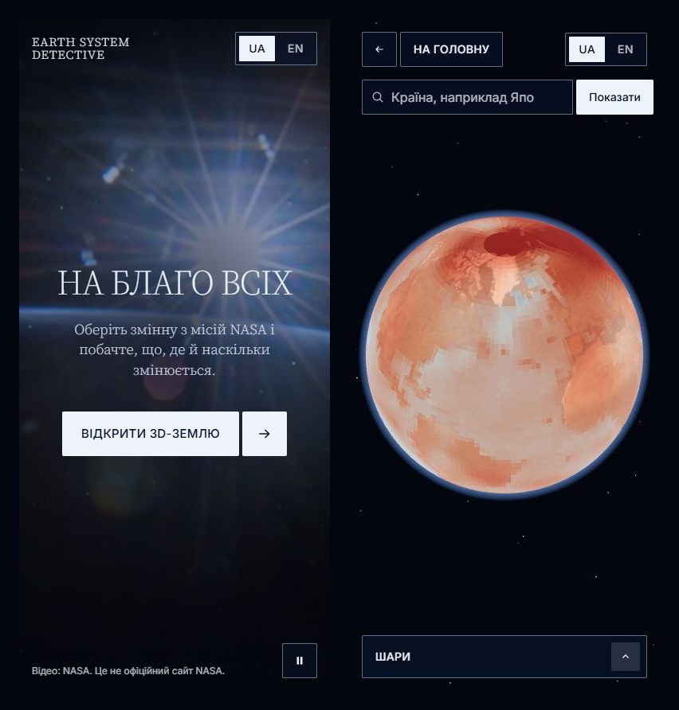

# Earth-System-Detective-
3 студєнта які приймають участь в хакатоні від Noosphere

**Українська** | [English](README.en.md)

---

**Earth System Detective** — наш проєкт для NASA Space Apps Challenge 2026,
челендж [Earth System Trend Detective](https://www.spaceappschallenge.org/2026/challenges/earth-system-trend-detective/).
Це 3D-Земля, на якій можна обрати змінну з даних NASA і побачити, що змінюється,
де, наскільки, і чи ця зміна статистично значуща.

**Сайт:** https://luufus.github.io/Earth-System-Detective-/


## Що вже є

### Головна сторінка

Один екран без прокрутки: відео NASA (схід Сонця над Землею з МКС, Земля вдень
і вночі, збирання та запуск супутника PACE), головна фраза «На благо всіх» і
кнопка переходу до 3D-Землі. Сайт працює українською та англійською.

### 3D-Земля (`/explore`)


- **Обертання й масштаб**: мишею, колесом або пальцями, до ~380 км над
  поверхнею. Під час наближення глобус довантажує з NASA GIBS чіткий знімок
  саме видимої ділянки (Blue Marble, 500 м на піксель).
- **Пошук країни**: вводите «Україна», «Японія» чи «Japan», і камера летить туди.
- **Кордони й назви країн**: міжнародні кордони й берегові лінії з NASA GIBS,
  назви країн мовою сайту.


### Шар «Температура поверхні» (NASA GISTEMP v4)

Аномалії температури відносно 1951–1980 років на сітці 2°×2°, 1880–2025 роки.

- **Рік**: аномалія за обраний рік.
- **Порівняння**: різниця між двома роками, наприклад 2025 мінус 1960.
- **Тренд**: швидкість зміни в кожній клітинці (°C за 10 років, нахил Тейла-Сена)
  і перевірка значущості тестом Манна-Кендалла. Незначущі клітинки (p ≥ 0,05)
  заштриховані.
- Наведіть курсор або торкніться глобуса, щоб побачити значення в точці.
  У легенді показано середнє по всій Землі.


### На телефоні



## Як запустити

```bash
cd frontend
npm install
npm run dev
```

Браузер відкриється сам. Подробиці про код, дані й оновлення GISTEMP описано у
[`frontend/README.md`](frontend/README.md), кольори, шрифти й компоненти — у
[`DESIGN.md`](DESIGN.md).

## Публікація

Кожен пуш у гілку `main` запускає GitHub Actions
([`.github/workflows/pages.yml`](.github/workflows/pages.yml)): сайт
збирається й викладається в гілку `gh-pages`, звідки його показує GitHub Pages.

## Структура репозиторію

| Шлях | Що там |
|---|---|
| `frontend/` | Застосунок на React + TypeScript + Vite, глобус на Three.js |
| `data-pipeline/` | Python-скрипти, що перетворюють набори даних NASA на файли для сайту |
| `docs/screenshots/` | Скріншоти для цього README |
| `DESIGN.md` | Дизайн-система: кольори, шрифти, компоненти |

## Джерела даних

NASA GISS (GISTEMP v4), NASA GIBS, NASA Image and Video Library, NASA JSC Crew
Earth Observations. Це не офіційний сайт NASA, і NASA не схвалює й не підтримує
цей проєкт.
