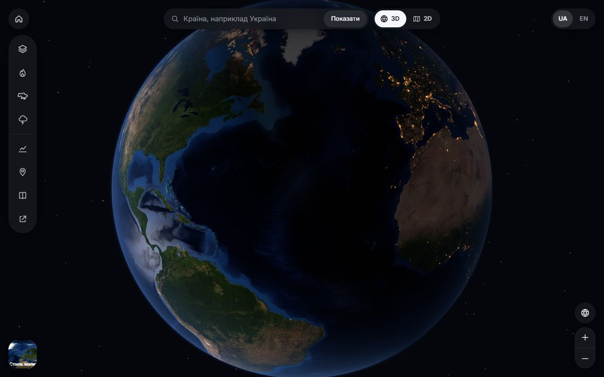
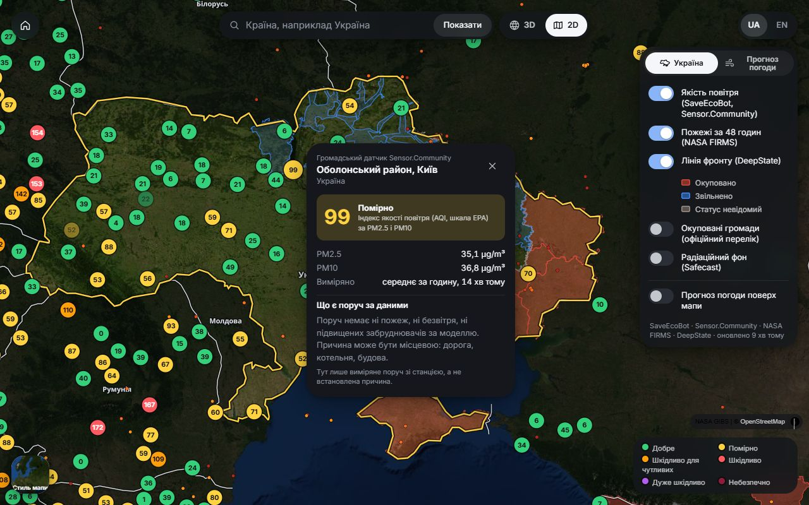
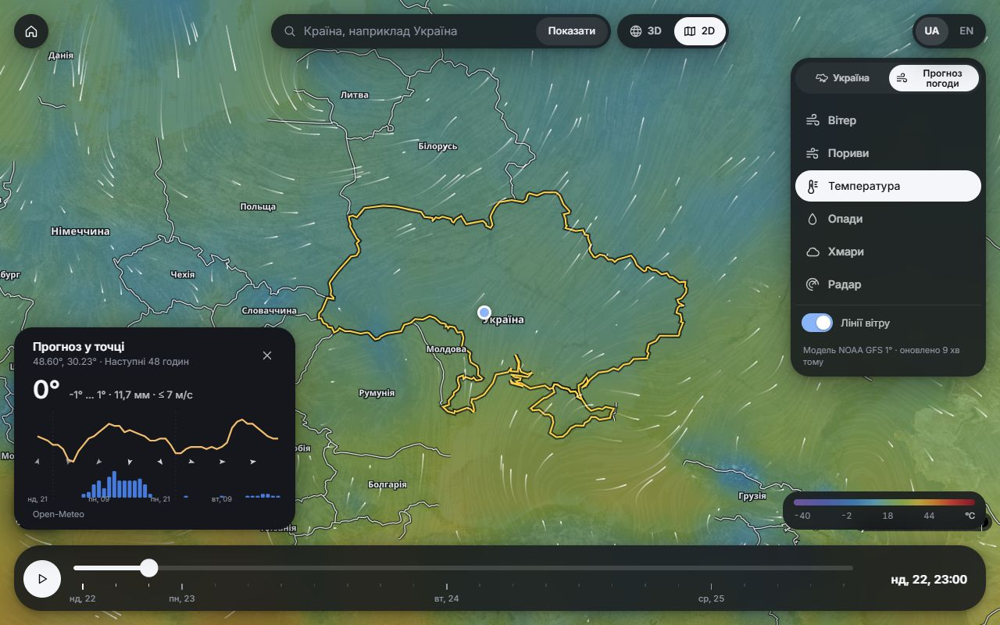
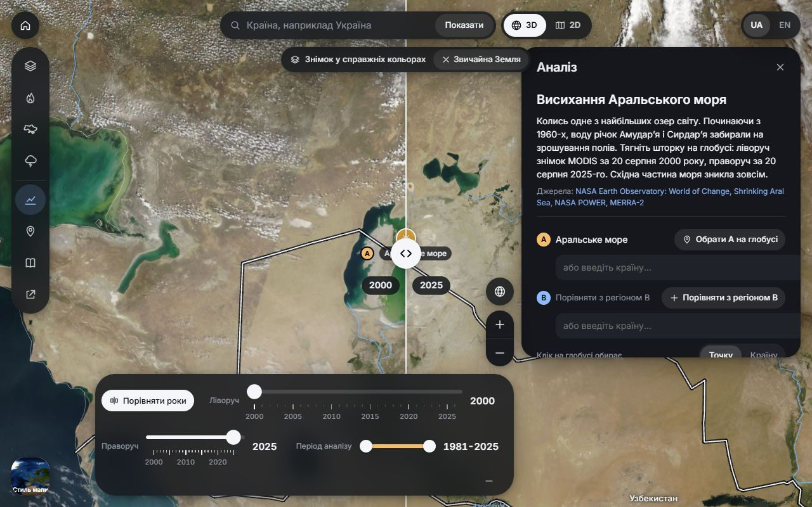
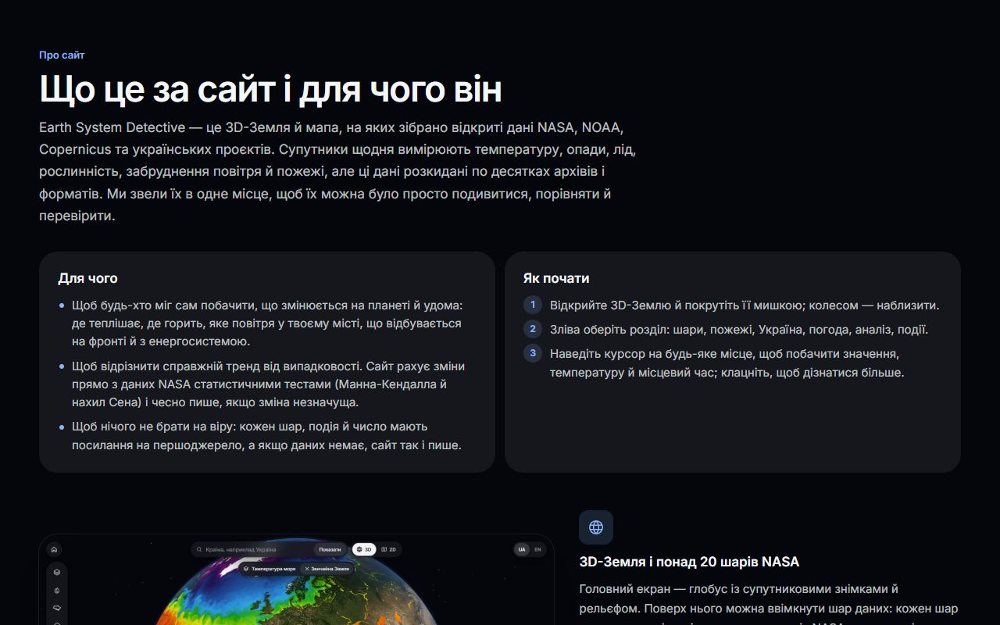

# Earth System Detective

**Українська** | [English](README.en.md)

**Жива 3D-Земля з відкритих даних NASA: що відбувається з планетою зараз, що змінилося за десятиліття
і що відбувається в Україні.**

**Сайт:** https://luufus.github.io/Earth-System-Detective-/ · **Автори:** IT Detectives (Семенов
Максим і Анастасія Чупира)


## Про проєкт

Супутники NASA й інших агентств щодня вимірюють температуру повітря й океану, опади, сніг і лід,
рослинність, забруднення повітря, пожежі, нічні вогні міст. Ці дані відкриті, але розкидані по
десятках архівів, форматів і сервісів, і пересічній людині до них важко дістатися. **Earth System
Detective** зводить їх в одне місце: на інтерактивний глобус і 2D-мапу, які можна просто відкрити в
браузері.

На сайті можна:

- **побачити** Землю такою, як її бачать супутники: понад 20 шарів даних NASA, справжнє Сонце й
  нічна сторона з вогнями міст, усі пожежі за останні 48 годин, вітер і прогноз погоди;
- **перевірити**, чи зміна справжня: сайт рахує тренд прямо з даних NASA статистичними тестами
  (Манна-Кендалла й нахил Сена) і простими словами пише, що змінилося, наскільки і чи це значуще;
- **порівняти** дві країни, два регіони чи два роки;
- **дізнатися**, що відбувається в Україні: якість повітря, лінія фронту, окуповані громади,
  радіаційний фон, пожежі й блекаути після ударів по енергосистемі;
- **зрозуміти** події: що сталося, чому, хто чи що спричинило і що можна зробити.

### Для чого

Новини про клімат і довкілля часто звучать як «стало гірше» без чисел і джерел. Ми хотіли, щоб
будь-хто — школяр, учитель, журналіст, волонтер — міг сам відкрити дані й побачити, що відбувається,
де і наскільки, і відрізнити справжній тренд від випадковості. Тому на сайті три правила:

1. **Тільки відкриті дані** з назвою джерела біля кожного шару, події й числа.
2. **Нічого не вигадувати.** Якщо даних немає, сайт так і пише; причини забруднення чи пожежі він
   називає лише ті, що видно в даних (вітер, опади, пожежі поруч, модель CAMS).
3. **Числа з перевіркою.** Тренд показується разом із тим, чи він статистично значущий.

### Історія

Проєкт почався на хакатоні **NASA Space Apps Challenge 2026** (челендж
[Earth System Trend Detective](https://www.spaceappschallenge.org/2026/challenges/earth-system-trend-detective/),
організатор у нас — Noosphere) як глобус з трендами температури. Після хакатону ми розвиваємо його
для себе: додали пожежі, Україну, погоду, якість повітря, події й новий дизайн.

## Зміст

- [3D-Земля і шари](#3d-земля-і-шари)
- [Справжнє Сонце, ніч і блекаут](#справжнє-сонце-ніч-і-блекаут)
- [Пожежі](#пожежі)
- [Мапа України](#мапа-україни)
- [Прогноз погоди](#прогноз-погоди)
- [Аналіз трендів і порівняння](#аналіз-трендів-і-порівняння)
- [Події](#події)
- [Головна сторінка й телефон](#головна-сторінка-й-телефон)
- [Як це працює](#як-це-працює)
- [Як запустити](#як-запустити)
- [Джерела даних](#джерела-даних)

## 3D-Земля і шари


Головний екран (`/explore`) — глобус на Three.js із супутниковими знімками NASA GIBS і рельєфом.
Зліва колонка інструментів: **Шари, Пожежі, Україна, Погода, Аналіз, Події, Глосарій, Поділитися**;
по центру пошук країни й перемикач 3D / 2D; знизу шкала часу.

- **Понад 20 шарів NASA на полицях**: температура (аномалія GISTEMP з 1880 року, повітря, поверхня
  суші, море), вода (опади GPM й MERRA-2, водяна пара, вологість, волога ґрунту, сніг, морський лід),
  повітря (діоксид азоту, озон, чадний газ, пил, аерозолі, вітер), суша (рослинність NDVI, типи
  земель, пожежі), люди (нічні вогні, густота населення).
- **Підказки до шарів**: під кожним шаром — шкала з числами й одиницями та пояснення, що означає
  колір; під курсором — значення в точці словами.
- **Програвач років**: «Від» — з якого року програвати до останнього; нижню панель можна згорнути.
- **Наближення до вулиць**: зблизька глобус довантажує чіткіший знімок видимої ділянки, а прогалини
  між проходами супутника заповнюються сусідніми значеннями, тож шари не розпадаються на «пікселі».
- **Кордони й назви**: кордони країн (Крим у складі України), столиці, моря, річки.


**Під курсором** будь-де на Землі: місце, температура зараз (NOAA GFS), вітер, місцевий час, значення
ввімкненого шару, пожежі й якість повітря поруч і найближча подія.

## Справжнє Сонце, ніч і блекаут



Три стилі освітлення: **рівне**, **справжнє Сонце зараз** (нічна сторона з вогнями міст NASA Black
Marble) і **вся планета вночі**.


**Блекаут**: Україна вночі 3 жовтня 2021 року і 25 листопада 2022 року (після масованих ударів по
енергосистемі) під шторкою «до / після».

## Пожежі


- **Пожежі зараз**: усі осередки за останні 48 годин із системи NASA FIRMS — прилади VIIRS
  (супутники NOAA-20, NOAA-21, Suomi NPP, 375 м) і MODIS (Terra, Aqua, 1 км). Колір показує, скільки
  годин тому побачено вогонь. Дані оновлюються щогодини; NASA публікує виявлення приблизно через
  1–3 години після прольоту.
- **В Україні за 7 днів**: кількість пожеж і графік по днях.
- **Історії великих пожеж** день за днем: Чорнобильська зона (квітень 2020), Луганщина (вересень —
  жовтень 2020), фронт (2022), Евбея й Туреччина (2021), Квебек (2023). Видно, як вогонь спалахує,
  жевріє й лишає згарище.


## Мапа України


Окрема 2D-мапа (`/map?mode=ukraine`, MapLibre): Україна підсвічена, сусіди затемнені (при віддаленні
до всього світу затемнення зникає). Стилі мапи: рельєф, супутник, OpenStreetMap.

- **Якість повітря**: число AQI (шкала US EPA) у кружечку; колір — від «добре» до «небезпечно».
  Дані SaveEcoBot, відкритих датчиків Sensor.Community і, з токеном, World Air Quality Index
  (WAQI). Виміри старші за 3 години напівпрозорі.
- **Картка станції**: район (OpenStreetMap), головний забруднювач, індекси PM2.5, PM10, NO₂, O₃, SO₂,
  CO, і що поруч за даними: пожежі, безвітря, опади, вологість, пил і гази з моделі Copernicus CAMS.
- **Лінія фронту DeepState** з історією від квітня 2022 року; **окуповані громади** за офіційним
  переліком Мінрозвитку; **радіаційний фон** Safecast у мкЗв/год; **пожежі** NASA FIRMS.
- Поверх мапи можна ввімкнути **прогноз погоди**.



## Прогноз погоди


Мапа в дусі Windy (`/map?mode=weather`): прогноз американської моделі **NOAA GFS** на 72 години з
кроком 3 години.

- Шари: **вітер** з анімацією ліній, **пориви**, **температура**, **опади**, **хмари** і **радар
  опадів** RainViewer за останні дві години.
- **Програвач прогнозу**: вітер плавно перетікає між кроками, кольоровий шар м'яко змінюється.
- **Прогноз у точці**: клацніть будь-де — температура й опади по годинах і найсильніший вітер
  (Open-Meteo).
- На 3D-Землі в розділі «Погода» — прогноз на 7 днів для будь-якого місця, ймовірність торнадо від
  NOAA Storm Prediction Center (лише США: інших офіційних даних немає) і «як часто тут буває» дощ,
  спека, мороз чи сильний вітер у 1981–2000 проти 2006–2025 років.



## Аналіз трендів і порівняння


Оберіть країну, область або точку (регіон A) — і панель «Аналіз» покаже ряд даних і перевірить, чи
є в ньому тренд.

- **Тест Манна-Кендалла**: чи зміна статистично значуща (світлофор надійності); для місяців і днів —
  сезонний варіант тесту.
- **Нахил Сена (Тейла-Сена)**: наскільки швидко йде зміна, з довірчим інтервалом.
- **Вигляди графіка**: роки, місяці, дні (добові дані NASA POWER) і сезонний цикл; графік
  масштабується, рухається, розгортається на весь екран і зберігається як картинка чи CSV.
- **Порівняння**: додайте регіон B — дві країни чи області на одному графіку, хто змінюється
  швидше. Країни обводяться на глобусі, а числа рахуються лише всередині їхніх кордонів.
- **«Як це рахується»**: для кожного методу — пояснення простими словами, формула й ті самі
  обчислення на ваших даних (S, Var(S), Z, p, нахил, інтервал).
- **Шар GISTEMP**: аномалія температури за рік, різниця двох років і тренд у кожній клітинці
  2°×2° з 1880 року; незначущі клітинки заштриховані.
- Той самий регіон можна відкрити в NASA Worldview, Giovanni, Earthdata Search і в сервісах
  CUAHSI (HydroShare, HydroClient).


## Події


Події, які видно в даних з космосу: пожежі, вирубка лісів, посухи, повені, танення льоду, вулкани,
забруднення повітря, спека, війна. На глобусі вони позначені значками за категоріями, а в розділі
«Події» — списком з фото. Натисніть подію — камера полетить на місце й увімкне потрібний шар. Для
кожної: **що сталося, чому, хто чи що спричинило і що можна зробити**, з фото Wikimedia Commons
(автори й ліцензії вказано) і посиланнями на джерела.



## Головна сторінка й телефон



Головна: відео NASA (схід Сонця над Землею з МКС, Земля вдень і вночі, запуск супутника PACE),
кнопки до 3D-Землі, погоди, пожеж і України, а нижче — розділ «Про сайт»: що це, для чого, як
почати, кожна частина сайту зі скріншотом, як оновлюються дані, для кого й автори. Кнопка
**«Джерела»** показує всі джерела даних. Сайт працює українською й англійською і на телефоні.

| Головна | Мапа України | 3D-Земля |
|---|---|---|
|  |  |  |

## Як це працює

**Браузер** (папка `frontend/`): React 19, TypeScript і Vite.

- **Глобус** — Three.js з власними шейдерами: денна й нічна сторона за справжнім положенням Сонця,
  рельєф, атмосфера. Знімки NASA GIBS вантажаться тайлами, зблизька — окремою чіткою латкою видимої
  ділянки.
- **2D-мапа** — MapLibre GL; вітер і кружечки станцій малюються на окремих полотнах поверх мапи.
- **Аналіз** — статистика в браузері: тести Манна-Кендалла (звичайний і сезонний), нахил Тейла-Сена
  з довірчим інтервалом.
- Анімації — пружини з дизайн-системи (Jelly slider, Stat card).

**Дані** (папка `data-pipeline/`, Python): деякі сервери не віддають дані браузеру з іншого сайту,
тому їх збирають скрипти й викладають як файли.

- `build_live.py` — прогноз NOAA GFS (власний читач формату GRIB2, без ecCodes), пожежі NASA FIRMS
  (VIIRS і MODIS), датчики Sensor.Community з фільтром несправних (значення, що в рази вищі за
  сусідів) і AQI за шкалою US EPA 2024. Дані стискаються, щоб сайт вантажився швидше.
- `build_fire_stories.py` — історії великих пожеж з архівів FIRMS.
- Інші скрипти готують GISTEMP, озонову діру, NO₂ і MODIS над Україною, окуповані громади,
  кордони й назви Natural Earth.

Решту браузер бере напряму: NASA GIBS і POWER, Open-Meteo і Copernicus CAMS, SaveEcoBot, WAQI,
RainViewer, DeepState, Safecast, OpenStreetMap Nominatim, Wikimedia Commons.

### Як оновлюються дані

| Що | Джерело | Як часто |
|---|---|---|
| Пожежі за 48 годин | NASA FIRMS (VIIRS, MODIS) | щогодини |
| Прогноз погоди | NOAA GFS 1° | щогодини (нові прогони кожні 6 годин) |
| Якість повітря | SaveEcoBot, Sensor.Community, WAQI | щогодини |
| Радар опадів | RainViewer | щокілька хвилин |
| Лінія фронту | DeepState | щойно публікується зміна |
| Шари й ряди NASA | GIBS, POWER, GISTEMP | щойно виходять нові місяці |

## Як запустити

```bash
cd frontend
npm install
npm run dev
```

Браузер відкриється сам. Поки працює `npm run dev`, сервер сам оновлює пожежі й повітря щогодини (а
прогноз GFS — коли йому понад 6 годин), запускаючи `data-pipeline/build_live.py` (потрібен Python з
numpy). Вручну: `npm run live`.

**Якість повітря WAQI.** Отримайте безкоштовний токен на https://aqicn.org/data-platform/token/ і
покладіть його у `frontend/.env.local` (цей файл не потрапляє в git):

```bash
VITE_WAQI_TOKEN=ваш_токен
```

Для сайту на GitHub Pages додайте той самий токен у секрет репозиторію `WAQI_TOKEN`
(Settings → Secrets and variables → Actions). Без токена сайт працює з SaveEcoBot і
Sensor.Community.

Подробиці про код, дані й оновлення GISTEMP — у [`frontend/README.md`](frontend/README.md), кольори,
шрифти й компоненти — у [`DESIGN.md`](DESIGN.md).

## Публікація

Кожен пуш у гілку `main` і щогодинний запуск за розкладом запускають GitHub Actions
([`.github/workflows/pages.yml`](.github/workflows/pages.yml)): свіжі пожежі, повітря й прогноз
збираються, сайт будується й викладається в гілку `gh-pages`, звідки його показує GitHub Pages.

## Структура репозиторію

| Шлях | Що там |
|---|---|
| `frontend/src/components/` | Глобус, мапа, панелі, картки |
| `frontend/src/pages/` | Сторінки: головна, 3D-Земля (`Explore`), 2D-мапа (`WeatherMap`) |
| `frontend/src/data/` | Завантаження й обробка даних у браузері |
| `frontend/src/analysis/` | Статистика: Манн-Кендалл, нахил Сена, ряди даних |
| `frontend/src/i18n/` | Тексти українською й англійською |
| `frontend/public/data/` | Підготовлені дані: GISTEMP, кордони, історії пожеж |
| `data-pipeline/` | Python-скрипти, що збирають і готують дані |
| `docs/screenshots/` | Скріншоти для цього README |
| `DESIGN.md` | Дизайн-система: кольори, шрифти, компоненти |

## Джерела даних

NASA GISS (GISTEMP v4), NASA GIBS, NASA POWER (MERRA-2), NASA Ozone Watch, OMI, MODIS, NASA FIRMS,
NASA Black Marble, NASA Image and Video Library, NASA JSC Crew Earth Observations; NOAA GFS; NOAA
Storm Prediction Center; RainViewer; Open-Meteo; Copernicus CAMS через Open-Meteo; DeepState;
SaveEcoBot; Sensor.Community; World Air Quality Index (WAQI); Safecast (CC0); перелік окупованих
громад Мінрозвитку України; карти Natural Earth (суспільне надбання) і OpenStreetMap (ODbL); фото
Wikimedia Commons (автори й ліцензії — у картках подій).

## Автори

**IT Detectives** — Семенов Максим і Анастасія Чупира. Сайт зроблено з Claude (Anthropic).

Це не офіційний сайт NASA, і NASA не схвалює й не підтримує цей проєкт.
